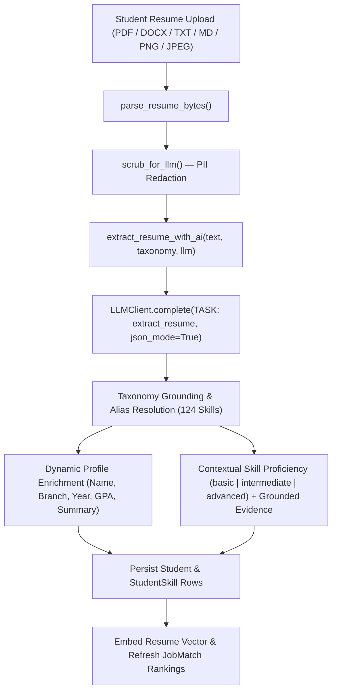
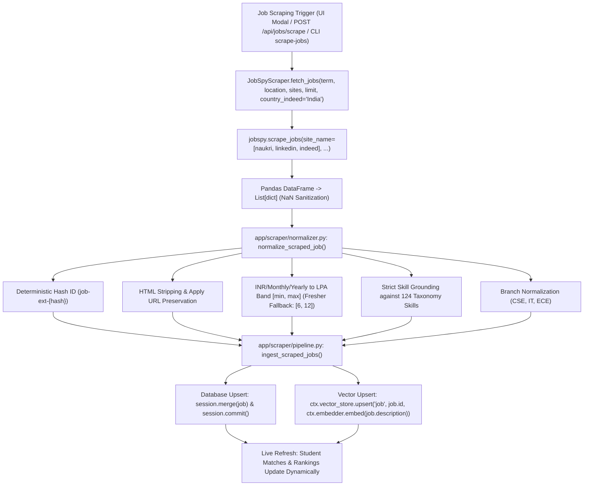
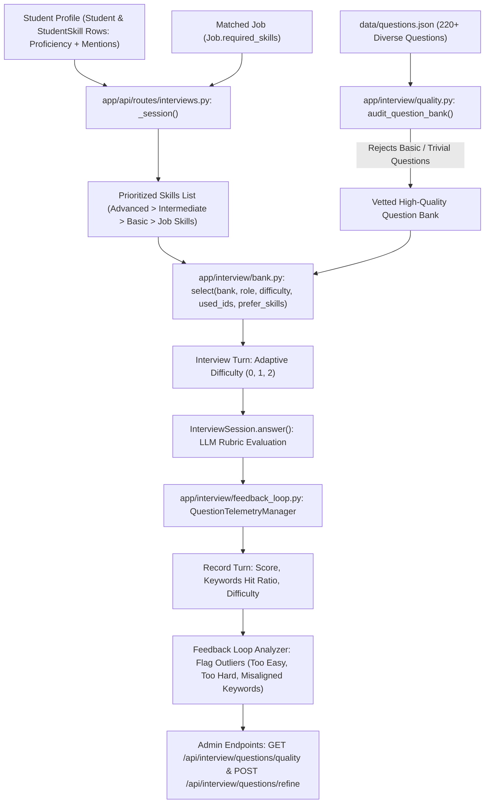
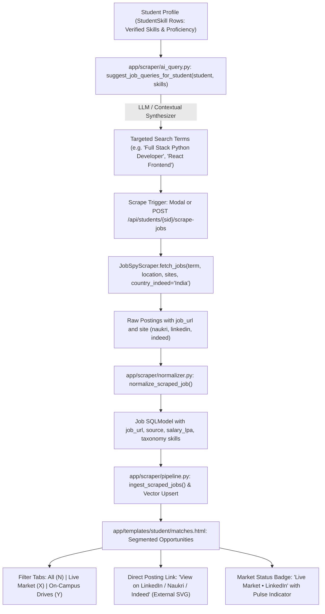
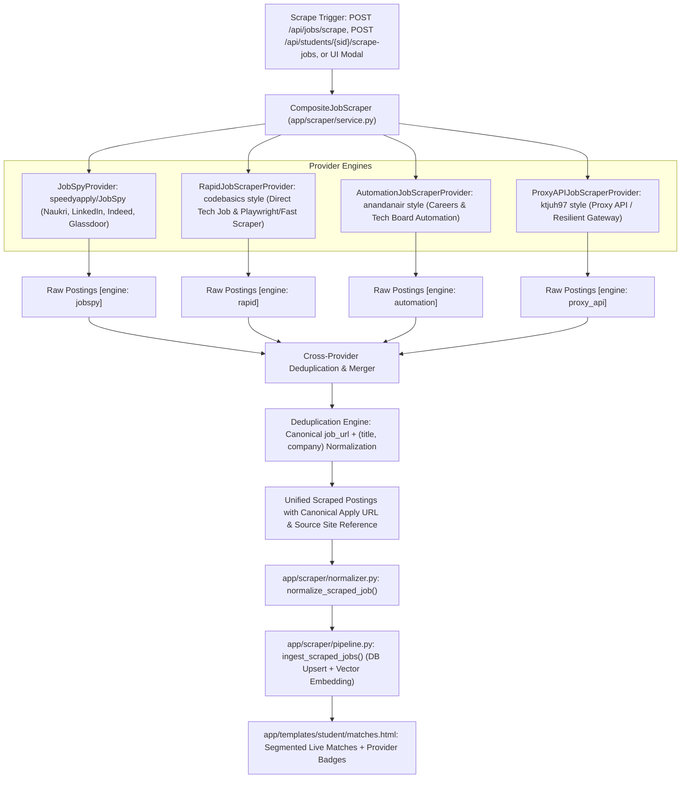
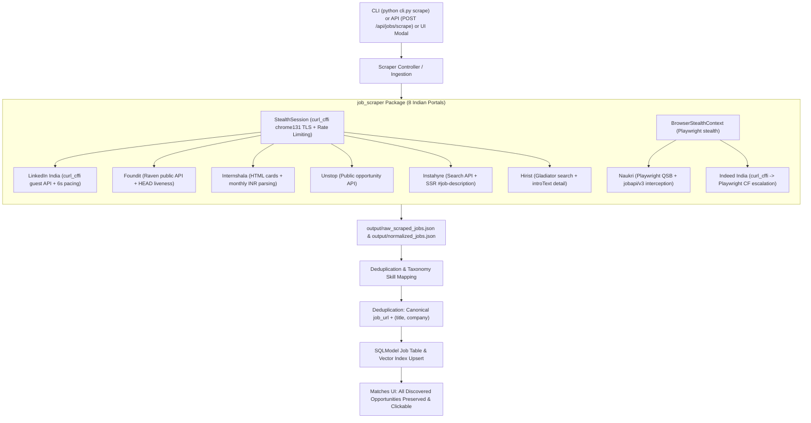

# JKLU CareerOS (PS-06) — System & Feature Architecture

## 1. Executive Overview

**JKLU CareerOS (PS-06 Placement Agent)** is an agentic placement and career-readiness platform built with FastAPI, SQLModel (SQLite with enforced foreign keys for unit testing; PostgreSQL 17 + `pgvector` for production), Jinja2/HTMX, and a pluggable `LLMClient` abstraction (`OpenAILLM`, `BedrockLLM`, and `MockLLM`).

### Milestone 1: Dynamic AI-Powered Resume & Skill Extraction
Previously, when a student uploaded or re-uploaded their resume, skill detection and proficiency grading (`basic`, `intermediate`, `advanced`) relied on `app/skills/extract.py` using static regex keyword matching (`ADVANCED_HINT`, `INTERMEDIATE_HINT`) and line-mention counts (`mentions >= 4`).

Milestone 1 replaced static keyword interception with a **dynamic, AI-powered resume extraction pipeline** (`TASK: extract_resume`) via the configured LLM API (`ctx.llm` / `get_llm(settings)`), ensuring that every student's resume upload is contextually analyzed and unique to their projects, internships, achievements, and experience depth.

### Milestone 2: Flagship Enterprise SaaS UI Overhaul & Zero-Emoji Design System
Milestone 2 elevates the entire JKLU CareerOS web portal (`app/templates/**/*.html` and `app/static/app.js`) to a **flagship enterprise SaaS standard** (inspired by Linear, Stripe Dashboard, and Vercel) while enforcing a **strict Zero-Emoji Policy** across all HTML templates and client-side JavaScript. Every decorative or functional emoji and HTML numeric/dingbat entity is replaced with precision inline stroke SVGs, semantic status pills, tabular typography (`Inter` + `JetBrains Mono`), and enterprise layout patterns.

### Milestone 3: Live Indian Job Scraping (`python-jobspy`), Taxonomy Normalization, Vector Indexing, API, CLI & UI Integration
Milestone 3 equips JKLU CareerOS with real-time external job aggregation using `python-jobspy>=1.1.70`, featuring first-class support for Indian tech platforms (**Naukri, LinkedIn India, Indeed India**). Ingested jobs are sanitized, stripped of HTML, normalized into LPA salary bands (converting INR monthly/yearly with fresher fallback), strictly grounded against the 124-skill taxonomy, merged idempotently into the SQLModel database, and indexed into the dense vector store. Candidates can trigger live job scraping directly from their match dashboard modal, via `POST /api/jobs/scrape`, or through the `scrape-jobs` CLI subcommand.

### Milestone 4: Profile-Driven Adaptive Interview Question Bank, High-Quality Expansion, Quality Auditor & Telemetry Feedback Loop
Milestone 4 significantly expands and enhances the AI mock interview question bank (`data/questions.json`) to over 220+ deep, scenario-driven technical questions spanning the full breadth of the 124-skill taxonomy. Crucially, the interview engine is upgraded to be **profile-driven**: interview questions are dynamically selected based on the student's extracted `StudentSkill` profile (prioritizing skills with advanced and intermediate proficiency) and role intersection. A standalone **Question Quality Auditor** (`app/interview/quality.py`) automatically evaluates questions and rejects basic, trivial definitions. Furthermore, a **Telemetry Feedback Loop** (`app/interview/feedback_loop.py`) continuously tracks question outcomes (average score, difficulty drift, keyword hit rates), auto-flagging outlier questions for continuous refinement.

### Milestone 5: Candidate Skill-Targeted AI Job Scraping, Direct Application Reference Links & Segmented Market View
Milestone 5 enhances live job discovery by making it candidate-specific: an AI query synthesizer analyzes a student's extracted `StudentSkill` profile and suggests targeted search terms to scrape live openings matching the candidate's exact strengths. Scraped jobs now preserve direct application reference links (`job_url` and `source` badge) linking candidates directly to the live posting on Naukri, LinkedIn, or Indeed. In the student matches portal (`matches.html`), live market opportunities are cleanly segregated from on-campus placement drives with interactive filter pills and visual market badges.

### Milestone 6: Multi-Provider Scraper Aggregator, Rapid Secondary Scrapers & Unified Deduplication Pipeline
Milestone 6 expands job ingestion into an open, extensible **Multi-Provider Scraper Aggregator (`CompositeJobScraper`)** integrating diverse open-source scraping strategies and workflows (inspired by `speedyapply/JobSpy`, `codebasics/job-scrapper`, `anandanair/job-scraper`, and proxy-based API adapters). It unifies results across multiple independent scraping engines, performs cross-provider deduplication (by canonical `job_url` and normalized `title::company`), enriches listing depth, and preserves direct application reference links to the original site. Candidates and TPOs can query across all scraper engines in parallel with automated error isolation and fallback.

---

## 2. System Data Flow (Dynamic Resume Upload Pipeline)



---

## 3. Milestone 1 Component & Contract Specifications

### 3.1 AI Resume Extraction Engine (`app/skills/extract.py` & `app/resume/extractor.py`)

Both `app/skills/extract.py` and `app/resume/extractor.py` (which re-exports the public extraction API for module path compatibility) expose the following contracts:

#### A. LLM System Prompt (`EXTRACT_RESUME_SYSTEM`)
Begins with `"TASK: extract_resume\n"` so `OpenAILLM`, `BedrockLLM`, and `MockLLM` route the task deterministically:

```python
EXTRACT_RESUME_SYSTEM = (
    "TASK: extract_resume\n"
    "You are an expert technical recruiter and AI resume parser. Analyze the candidate's "
    "resume dynamically and extract:\n"
    "1. Candidate profile metadata (name, branch, year, gpa, summary) if present in the text.\n"
    "2. Every technical and soft skill from the provided taxonomy that the candidate demonstrates.\n"
    "For each skill, determine proficiency level ('basic', 'intermediate', or 'advanced') "
    "dynamically based on contextual depth in the resume:\n"
    "- 'advanced': production internships/work experience, complex end-to-end systems, architectural ownership, quantified impact metrics, or deep multi-project mastery.\n"
    "- 'intermediate': applied hands-on project implementation, practical framework/tool usage, or multiple distinct applied contexts.\n"
    "- 'basic': listed only in a skills section, introductory coursework, or brief single mention without applied project depth.\n"
    "You MUST only return skills that exist in the provided taxonomy and are grounded in the resume text.\n"
    "Respond ONLY with valid JSON matching this schema:\n"
    '{"profile": {"name": str, "branch": str, "year": int, "gpa": float, "summary": str}, '
    '"skills": [{"skill_id": str, "level": "basic"|"intermediate"|"advanced", "mentions": int, "evidence": [str]}]}'
)
```

#### B. Primary Extraction Functions

1. **`extract_resume_with_ai(text: str, taxonomy: Taxonomy, llm: object | None = None) -> dict`**
   - Parses PII-scrubbed resume text via `llm.complete(system=EXTRACT_RESUME_SYSTEM, user=payload, json_mode=True)`.
   - Grounds all returned `skill_id`s against `taxonomy` (124 skills) and verifies text/evidence grounding.
   - Merges explicit word-boundary taxonomy matches with contextual proficiency grading.
   - Gracefully falls back to deterministic contextual analysis on `llm is None` or LLM errors.
2. **`extract_skills_with_llm(text: str, taxonomy: Taxonomy, llm: object | None = None) -> dict[str, dict]`**
3. **`extract_skills(text: str, taxonomy: Taxonomy, llm: object | None = None) -> dict[str, list[str]]`**
4. **`level_for(mentions: int, evidence_lines: list[str] | None = None, *, llm: object | None = None, skill_id: str | None = None, resume_text: str | None = None, taxonomy: Taxonomy | None = None) -> str`**
5. **`app/resume/extractor.py`**: Re-exports the extraction API.

### 3.2 Contextual `MockLLM` Handler (`app/llm/mock.py`)
Supports `task == "extract_resume"` with contextual proficiency analysis (`advanced`, `intermediate`, `basic`) and candidate metadata extraction (`name`, `branch`, `year`, `gpa`, `summary`).

### 3.3 API Routes & Upload Flow (`app/api/routes/students.py` & `app/api/routes/pages.py`)
- `create_student_core` and `create_student_core_resume` use `extract_resume_with_ai(...)` and backfill omitted student profile fields (`name`, `branch`, `year`, `gpa`).
- `POST /api/resumes/extract` and `POST /api/students/{sid}/resume` provide JSON extraction endpoints.

---

## 4. Milestone 2 Specifications: Flagship Enterprise SaaS UI Overhaul & Zero-Emoji Design System

### 4.1 Design System Foundations & Strict Zero-Emoji Policy

1. **Strict Zero-Emoji Mandate (Global Hard Gate)**:
   - **Prohibited Characters & Entities**:
     - Zero Unicode emoji codepoints (including ranges `U+1F300`–`U+1FAFF`, `U+2600`–`U+27BF`, `U+2300`–`U+23FF`, such as `✅`, `❌`, `➕`, `⏳`, `🎤`, `⏹`, `🏠`, `👤`, `🎯`, `📋`, `📈`, `🤖`, `📊`, `📜`).
     - Zero HTML numeric or hex entities referencing emojis, dingbats, or pictographs (such as `&#8962;`, `&#128100;`, `&#127919;`, `&#128203;`, `&#128200;`, `&#127908;`, `&#129302;`, `&#128202;`, `&#9989;`, `&#128220;`, `&#9776;`, `&#10003;`, `&#10007;`).
   - **Replacement Standard**:
     - Use crisp inline stroke SVGs (`width="16" height="16"` or Tailwind `w-4 h-4` / `w-5 h-5`, `viewBox="0 0 24 24"`, `fill="none"`, `stroke="currentColor"`, `stroke-width="1.75"`, `stroke-linecap="round"`, `stroke-linejoin="round"`).
     - Use clean typographic badges, semantic status dots (`<span class="w-1.5 h-1.5 rounded-full ..."></span>`), and CSS/SVG spinners for async loading states (`Generating plan...`, `Evaluating response...`, `Recording...`).

2. **Typography & Color Palette**:
   - **Fonts**: Load Google Fonts `Inter` (`400;500;600;700`) and `JetBrains Mono` (`400;500;600`) in `base.html`.
   - **Numeric Discipline**: Apply `tabular-nums` (`font-variant-numeric: tabular-nums`) on all scores, percentages, GPAs, counters, timers, and data tables.
   - **Surface Architecture**:
     - Sidebar (`#sidebar`): Deep obsidian slate (`bg-slate-950 text-slate-300 border-r border-slate-800/80`) with active/hover indicator pills (`hover:bg-slate-900 hover:text-white`), structured section headers (`text-[11px] font-semibold uppercase tracking-wider text-slate-500`), and a refined brand header with an inline geometric vector mark.
     - Topbar (`#topbar`): Frosted glass sticky header (`bg-white/85 backdrop-blur-md border-b border-slate-200/80 sticky top-0 z-20`), command search input (`#command-input`) with `<kbd>` shortcut badge (`Ctrl K`), segmented role switcher (`#role-pill`, `#role-badge`, `.role-opt`), student quick-switcher (`#switch-student`), and Agent Brain trigger button (`#open-drawer`) with live pulse dot.
     - Main Workspace: Subtle warm/cool neutral canvas (`bg-[#F8FAFC]`) with high-contrast white cards (`bg-white rounded-xl border border-slate-200/80 shadow-xs`), crisp section headers, and structured empty states.

---

### 4.2 File-by-File UI Overhaul Specifications

#### 1. `app/templates/base.html` (Application Shell, Navigation, Topbar & Agent Drawer)
- **Remove all HTML emoji entities** (`&#8962;`, `&#128100;`, `&#127919;`, `&#128203;`, `&#128200;`, `&#127908;`, `&#129302;`, `&#128202;`, `&#9989;`, `&#128220;`, `&#9776;`).
- **Sidebar (`#sidebar`)**:
  - Brand Lockup: Custom geometric SVG emblem (`bg-indigo-600/15 border border-indigo-500/30 text-indigo-400 rounded-lg p-2`), title `"JKLU CareerOS"`, subtitle `"Autonomous Placement"` with a subtle `"PS-06"` mono badge.
  - Navigation Items: Every link includes a clean `w-4 h-4` stroke SVG icon (Home/Grid, User Profile, Target/Matches, Layers/Plan, TrendingUp/Progress, Mic/Interview, Sparkles/Placement Copilot, BarChart/Analytics, ShieldCheck/Approvals, Terminal/Audit trail) and active-path highlighting.
  - Student Switcher (`#student-switcher`): Styled dark-mode select control (`bg-slate-900 border-slate-800 text-slate-200`) when no `sid` is active, or active student context card with quick `"Change"` link when `sid` is set.
- **Topbar (`#topbar`)**:
  - Mobile menu button (`#menu-btn`) uses a 3-bar hamburger SVG icon.
  - Command bar (`#command-bar`, `#command-input`) features a search magnifier SVG icon and a right-aligned `<kbd>Ctrl K</kbd>` keycap badge.
  - Role Switcher (`#role-pill`): Segmented control container (`bg-slate-100 p-1 rounded-lg border border-slate-200`) containing `#role-badge` and `.role-opt` buttons (`Student`, `Mentor`, `TPO Admin`).
  - Agent Brain button (`#open-drawer`): Styled enterprise action pill (`bg-slate-900 hover:bg-slate-800 text-white`) with an inline CPU/circuit SVG and emerald status indicator.
- **Agent Brain Slide-Over Drawer (`#agent-drawer`)**:
  - Dark terminal aesthetic (`bg-slate-950 border-l border-slate-800`) with structured header, live pipeline description, `"Run full pipeline"` primary button (`#drawer-run`) with play SVG icon, `"Close"` button (`#close-drawer`), and monospace trace log (`#drawer-trace`).

#### 2. `app/templates/index.html` (Workspace Home: Student Directory & AI Resume Onboarding)
- Upgrade from a bare `<br>` link list into a flagship 2-column enterprise workspace (`grid-cols-1 lg:grid-cols-12 gap-8`):
  - **Page Header Banner**: Clean executive header with title, subtitle, and summary stat pills (Active Cohort Count, AI Extraction Engine Status, Taxonomy Coverage).
  - **Left Column (`lg:col-span-7`) — Student Cohort Directory**:
    - Search/filter or structured directory card listing all students (`students`) with avatar initials badge, full name link (`href="/students/{{ s.id }}"`), branch pill (`s.branch`), academic year badge (`Y{{ s.year }}`), tabular GPA indicator, and quick-action links (`Profile`, `Matches`, `Plan`).
    - Clean empty state when `students` is empty.
  - **Right Column (`lg:col-span-5`) — AI-Assisted Resume Onboarding Card**:
    - Structured form (`action="/upload" method="post" enctype="multipart/form-data"`) with a styled drag-and-drop file upload zone (`id="resume-file-input" name="file"`), format badges (`PDF`, `DOCX`, `TXT`, `MD`, `PNG`, `JPG`), AI auto-fill preview banner (`#ai-preview`, `#ai-skills`), 2-column metadata grid (`name`, `branch`, `year`, `gpa`), and a prominent primary submit button (`"Upload & Run AI Extraction"`).

#### 3. `app/templates/student/profile.html` & `app/templates/student/_skill_chips.html` (Candidate Profile & Verified Skill Matrix)
- **Candidate Header Card (`profile.html`)**:
  - Avatar monogram, candidate name (`student.name`), branch/year/GPA metric pills, and a security/governance badge showing PII items redacted (`student.pii_redacted_count`) with a shield-check SVG icon.
  - Quick navigation action bar (`View Job Matches`, `Upskilling Plan`, `Mock Interview`).
- **Two-Column Content Layout (`profile.html`)**:
  - **Verified Skill Matrix Card**: Renders `#skill-chips` via `_skill_chips.html` with a legend for `Advanced`, `Intermediate`, and `Basic` proficiency tiers.
  - **Resume Re-Upload & Live Refresh Card**: Styled HTMX upload form (`hx-post="/students/{{ sid }}/resume" hx-target="#skill-chips" hx-encoding="multipart/form-data"`) with clear helper text and primary submit button.
- **Skill Chips Partial (`_skill_chips.html`)**:
  - Preserves `.chip` and `.badge` classes for test compatibility while styling each skill chip as a structured pill:
    - `advanced`: Indigo/emerald high-proficiency styling (`bg-indigo-50/80 border-indigo-200 text-indigo-950` with `bg-indigo-600 text-white` badge).
    - `intermediate`: Sky/blue styling (`bg-sky-50/80 border-sky-200 text-sky-950` with `bg-sky-600 text-white` badge).
    - `basic`: Neutral slate styling (`bg-slate-50 border-slate-200 text-slate-800` with `bg-slate-200 text-slate-700` badge).
  - Displays mention count (`s.mentions`) in tabular monospace and preserves `title` tooltip with grounded resume evidence.

#### 4. `app/templates/student/matches.html` (Explainable Hybrid Job Match Matrix)
- **Remove all emojis and dingbat entities** (`✅`, `❌`, `➕`, `⏳`, `&#10003;`, `&#10007;`).
- **Top Action Header**:
  - Title (`"Job Matches — {{ student.name }}"`), methodology subtitle (`"Hybrid lexical, dense vector, and skill-graph alignment with grounded resume evidence"`), and primary `"Re-run matching"` button (`POST /api/students/{{ sid }}/match`).
- **Empty State (`not has_matches`)**:
  - Enterprise empty-state card with target SVG icon, explanation, and primary `"Run matching"` button.
- **Match Cards (`rows`)**:
  - **Card Header**: Rank badge (`#1`, `#2`, ...), Job Title & Company, Tier badge (`super_dream` in violet/amber, `dream` in indigo, `standard` in slate), Eligibility status pill (`"Eligible"` in emerald with check SVG vs. `"Not eligible ({{ m.ineligible_reason }})"` in rose with alert SVG), and a prominent tabular Composite Score badge (`{{ (m.score * 100)|round(1) }}%`) alongside sub-metric pills (`Skill`, `Dense`, `Lexical`) and `"Generate plan for this job"` button (`data-job="{{ j.id }}"`).
  - **Three-Column Explainability Grid**:
    1. **Matched Required (`Matched required`)**: Check-circle SVG header in emerald; renders matched skill pills and quoted resume evidence snippets (`ev`) in clean monospace-accented evidence blocks.
    2. **Missing Required (`Missing required`)**: Alert-circle SVG header in rose; renders missing skill gap pills (`m.missing_skills`) in rose badges (`bg-rose-50 text-rose-700 border-rose-200`).
    3. **Preferred (`Preferred`)**: Plus-circle SVG header in indigo/slate; renders matched preferred skills (`m.extra_skills`) in indigo badges.
  - **Inline Script**: When `"Generate plan for this job"` is clicked, sets button text to `"Generating plan..."` (NO `⏳` emoji!).

#### 5. `app/templates/student/plan.html` (30-Day Personalized Upskilling Roadmap)
- **Remove `⏳` emoji** from `#regen-btn` click handler (`btn.textContent = "Generating plan with AI...";`).
- **Header & Progress Overview Card**:
  - Displays student name, `"Regenerate plan (AI)"` button (`#regen-btn`) with sparkles/refresh SVG, total hours completed (`{{ plan.completed_hours }} / {{ plan.total_hours }} hrs`), percentage readout (`{{ pct }}%`), and smooth progress bar (`#plan-bar`).
- **AI Advisor Narrative Callout**:
  - When `plan.narrative` is present, renders inside a structured executive brief card (`border-l-4 border-indigo-600 bg-indigo-50/40`) with an advisor SVG icon.
- **Curriculum Roadmap Table**:
  - Enterprise table with columns: `Timeline`, `Target Skill`, `Recommended Course & Provider`, `Effort`, `Cost`, `Rationale`, and `Status`.
  - Preserves `<tr id="row-{{ it.id }}">` and the HTMX completion button (`hx-post="/api/plans/{{ plan.id }}/items/{{ it.id }}/complete"`).

#### 6. `app/templates/student/progress.html` (Readiness Trajectory & Activity Ledger)
- **Executive Summary Strip**: KPI cards for `Current Readiness Score`, `Best Matched Role & Band`, and `Logged Milestones ({{ events|length }})`.
- **Readiness Curve Card**: Polished container housing `<canvas id="readinessChart" height="90"></canvas>` and `#chart-empty` fallback message.
- **Activity Ledger Table**: Clean tabular timeline displaying `Timestamp`, `Event Type` (badge), `Score Delta` (`+`/`-` in emerald/rose tabular monospace), and `Notes`.

#### 7. `app/templates/student/interviews.html` & `app/templates/student/interview.html` & `app/static/app.js` (Adaptive AI Mock Interview Studio)
- **Remove all emojis and emoji escapes**:
  - In `app/templates/student/interview.html`: Remove `&#127908;` from `#listen` and `#mic` buttons; replace with inline speaker/volume SVG and microphone SVG icons.
  - In `app/static/app.js`:
    - Line 153: Change `'Evaluating with AI… ⏳'` to `'Evaluating with AI...'`.
    - Line 158: Change `'⏳ AI is evaluating...'` to `'AI is evaluating response...'`.
    - Lines 321–325: Change `"\u{1F3A4} Record"` / `"\u23F9 Stop"` to `"Record"` / `"Stop"` (or preserve inner SVG + text without any Unicode emojis).
- **Interview Hub (`interviews.html`)**:
  - Hero launch card with `"Start new mock interview"` button (`#startInterviewBtn`) and structured feature highlights (8-Turn Adaptive Difficulty, Real-Time 3-Axis Rubric, Printable Executive Scorecard).
  - Past sessions table/grid showing interview ID link, status badge (`active` / `completed`), and overall score bar.
- **Live Interview Studio (`interview.html`)**:
  - Wrapped in the flagship design system (loading Inter + JetBrains Mono and Tailwind utilities, with a clean studio topbar linking back to `/students/{{ iv.student_id }}/interviews` and `/`).
  - Preserves every required ID and class (`#stepper`, `.turn-dot`, `#difficulty-badge`, `#rubric`, `#rubric-technical_accuracy`, `#rubric-val-technical_accuracy`, `#rubric-depth_and_examples`, `#rubric-val-depth_and_examples`, `#rubric-communication_clarity`, `#rubric-val-communication_clarity`, `#keywords`, `#toggle-ideal`, `#ideal-answer`, `#pulse`, `#timer`, `#listen`, `#mic`, `#answer`, `#send`, `#summary`, `#print-btn`, `printScorecard`, `#score`, `#summary-feedback`, `#bars`, `#rubric-overall`, `#interview-id`, `/static/app.js`).

#### 8. `app/templates/copilot.html` (Placement Policy & Cohort AI Copilot)
- Upgrade into a flagship two-column AI workbench:
  - **Header & Student Context Selector**: Title, grounded SOP RAG badge, and `#copilot-student` selector.
  - **Quick-Prompt Pills (`#quick-prompts`, `.quick-prompt`)**: Styled interactive prompt chips with subtle hover elevation.
  - **Conversation Stream (`#chat-log`) & Composer (`#copilot-input`, `#copilot-send`)**: Clean enterprise chat interface with distinct user/assistant message cards and interactive `.citation-pill` badges (`[SOP-01]`, `[SOP-02]`, etc.).
  - **Grounded Citations & Agent Trace Sidebar (`#copilot-trace`)**: Structured monospace step inspector showing tool invocations and retrieved SOP documents.

#### 9. `app/templates/admin/analytics.html`, `app/templates/admin/approvals.html`, `app/templates/admin/audit.html` (TPO Executive Command Center)
- **`analytics.html`**:
  - Executive header with `"TPO Cohort Analytics"` title, subtitle containing `"readiness"`, and export toolbar (`#export-csv`, `#export-json`).
  - 4-card KPI strip (`#kpi-strip`) with subtle top accent bars, uppercase labels, and large tabular-num metrics.
  - 2-column chart grid (`#gapChart`, `#bandChart`) inside crisp white cards.
  - Department Readiness Breakdown table (`dept_breakdown`) with visual readiness progress bars.
  - Bootcamp Intervention launcher card (`#launch-bootcamp`) and At-Risk Students table (`at_risk`) with status badges.
- **`approvals.html`**:
  - Structured governance queue header and `#approvals` card list.
  - Each item displays status pill (`pending` in amber, `approved` in emerald, `rejected` in rose), action type badge, payload summary in `JetBrains Mono`, and `.note-input` + `"Approve"` / `"Reject"` controls.
- **`audit.html`**:
  - Live filter bar (`#audit-filter`) with search icon and live entry counter (`#audit-count`).
  - Enterprise data grid (`#audit-log`) with monospace timestamps, actor pills, action badges, resource identifiers, and structured payload JSON preview.

---

### 4.3 Mandatory DOM & Text Contracts (Zero Test Regressions)

Every template edit MUST preserve these exact DOM IDs, classes, attributes, and text substrings tested by `tests/test_sui_shell.py`, `tests/test_dashboard.py`, `tests/test_interview.py`, and `tests/test_interview_rubric.py`:

| File | Required DOM IDs / Classes / Attributes / Substrings |
| :--- | :--- |
| `app/templates/base.html` | `id="sidebar"`, `id="topbar"`, `id="command-bar"`, `id="command-input"`, `id="open-drawer"`, `id="close-drawer"`, `id="agent-drawer"`, `id="drawer-run"`, `id="drawer-trace"`, `id="toast-root"`, `id="role-pill"`, `id="role-badge"`, `.role-opt`, `data-role-value`, `/api/auth/switch-role`, `id="switch-student"`, `id="student-switcher"`, `"JKLU CareerOS"`, `"Autonomous Placement"`, `/static/app.js` |
| `app/templates/index.html` | Student names & `/students/{{ s.id }}` links, `"upload"` (case-insensitive), `action="/upload"`, `name="file"`, `name="name"`, `name="branch"`, `name="year"`, `name="gpa"`, `#ai-preview`, `#ai-skills`, `/api/resumes/extract` |
| `app/templates/student/profile.html` & `_skill_chips.html` | `id="skill-chips"`, `hx-post="/students/{{ sid }}/resume"`, `hx-target="#skill-chips"`, `.chip`, `.badge` |
| `app/templates/student/matches.html` | `"Run matching"` (when `not has_matches`), `"Missing"` and `"Generate plan"` (when `has_matches`), `data-job="{{ j.id }}"` |
| `app/templates/student/plan.html` | `id="plan-bar"`, `id="row-{{ it.id }}"`, `id="regen-btn"`, `hx-post="/api/plans/{{ plan.id }}/items/{{ it.id }}/complete"` |
| `app/templates/student/progress.html` | `id="readinessChart"`, `id="chart-empty"`, `"Chart"` or `"chart.js"` |
| `app/templates/student/interviews.html` | `id="startInterviewBtn"`, `"Start"` and `"interview"` (case-insensitive) |
| `app/templates/student/interview.html` | `id="stepper"`, `turn-dot`, `id="difficulty-badge"`, `id="rubric"`, `id="rubric-technical_accuracy"`, `id="rubric-val-technical_accuracy"`, `id="rubric-depth_and_examples"`, `id="rubric-val-depth_and_examples"`, `id="rubric-communication_clarity"`, `id="rubric-val-communication_clarity"`, `id="keywords"`, `id="toggle-ideal"`, `id="ideal-answer"`, `id="pulse"`, `id="timer"`, `id="listen"`, `id="mic"`, `id="answer"`, `id="send"`, `id="summary"`, `id="print-btn"`, `printScorecard`, `id="score"`, `id="summary-feedback"`, `id="bars"`, `id="rubric-overall"`, `id="interview-id"`, `/static/app.js` |
| `app/templates/copilot.html` | `id="chat-log"`, `id="copilot-input"`, `id="copilot-send"`, `id="copilot-student"`, `id="quick-prompts"`, `.quick-prompt`, `.citation-pill`, `SOP-`, `[SOP-01]`, `id="copilot-trace"` |
| `app/templates/admin/analytics.html` | `id="kpi-strip"`, `id="export-csv"`, `id="export-json"`, `id="gapChart"`, `id="bandChart"`, `id="launch-bootcamp"`, `"Bootcamp"`, `/api/approvals`, `"analytics"` and `"readiness"` (case-insensitive) |
| `app/templates/admin/approvals.html` | `id="approvals"`, `"Approve"`, `"Reject"`, `.note-input` |
| `app/templates/admin/audit.html` | `id="audit-log"`, `id="audit-filter"`, `id="audit-count"`, `/api/admin/audit` |
| Global (`app/templates/**/*.html` & `app/static/app.js`) | Zero `alert(` calls; **Zero Unicode emojis or HTML emoji/dingbat entities**. |

---

## 6. Milestone 3 Specifications: Live Indian Job Scraping (`python-jobspy`), Taxonomy Normalization, Vector Indexing, API, CLI & UI Integration

### 6.1 Architectural Goals & System Data Flow

Milestone 3 equips JKLU CareerOS with real-time automated job discovery from live Indian tech hiring channels using the open-source `python-jobspy>=1.1.70` library, with first-class support for **Naukri, LinkedIn India, and Indeed India**.



### 6.2 Component & Contract Specifications

#### A. Dependency Specification (`pyproject.toml`)
- Add `python-jobspy>=1.1.70` to the project dependencies in `pyproject.toml`.
- Execute `uv sync` in the repository root to install `python-jobspy` and its network/parsing dependencies in `.venv`.

#### B. Scraper Service (`app/scraper/service.py`)
- Exposes class `JobSpyScraper`:
  ```python
  class JobSpyScraper:
      def fetch_jobs(
          self,
          search_term: str = "Software Engineer",
          location: str = "Bengaluru",
          sites: list[str] | None = None,
          results_wanted: int = 20,
          hours_old: int = 168,
          country_indeed: str = "India",
      ) -> list[dict]:
          ...
  ```
- **Validation**: Ensures `sites` only contains valid platforms: `"naukri"`, `"linkedin"`, `"indeed"`. Defaults to `["naukri", "linkedin", "indeed"]` if not specified.
- **Resilience & Error Handling**:
  - Catches network timeouts, connection resets, scraper parse errors, and Cloudflare challenges.
  - Logs warnings/errors using Python standard `logging.getLogger(__name__)`.
  - Returns successfully parsed jobs or an empty list `[]` without raising unhandled 500 exceptions.
- **DataFrame Sanitization**:
  - Converts `pandas.DataFrame` via `df.to_dict(orient="records")`.
  - Replaces all `NaN` / `float('nan')` / `pd.isna` values with safe Python primitives (`None`, `""`, or `0`).

#### C. Normalizer & Taxonomy Grounding (`app/scraper/normalizer.py`)
- Exposes function `normalize_scraped_job(raw: dict, taxonomy: Taxonomy) -> Job`:
  - **Deterministic ID**: Computes `job_url = raw.get("job_url") or raw.get("url") or ""`.
    - If `job_url`: `job_id = f"job-ext-{hashlib.md5(job_url.strip().encode()).hexdigest()[:10]}"`.
    - If missing: `job_id = f"job-ext-{uuid.uuid4().hex[:8]}"`.
    - Ensures identical jobs re-scraped across sessions update idempotently rather than duplicating.
  - **Title & Company**: Strips extra whitespace, providing safe fallbacks (`"Software Engineer"` / `"Tech Employer"`).
  - **HTML Stripping & Description**:
    - Removes HTML tags (`<p>`, `<div>`, `<br>`, `<li>`, `<span>`, etc.) and decodes HTML entities.
    - Preserves apply URL at the bottom: `\n\nApply URL: {job_url}`.
  - **Salary LPA Conversion**:
    - Scraped fields: `min_amount`, `max_amount`, `currency`, `interval`.
    - If currency is INR / ₹ (or amount suggests INR):
      - If interval is yearly/annual: `round(amount / 100_000)` (e.g. ₹8,00,000 -> 8 LPA).
      - If interval is monthly: `round(amount * 12 / 100_000)` (e.g. ₹50,000/mo -> 6 LPA).
      - If amount is <= 100 (e.g., 6 to 18), treated directly as LPA.
    - If missing, 0, or unparseable: defaults to Indian fresher tech band `[6, 12]` LPA.
    - Always emits a `list[int]` of two positive integers `[min_lpa, max_lpa]`.
  - **Strict Taxonomy Skill Grounding (124 Skills)**:
    - Scans combined text (`title + " " + description + " " + tags`) against `taxonomy.alias_map` using word-boundary matching.
    - Resolves every matched skill via `taxonomy.resolve(skill)` to ensure it belongs to the canonical 124-skill taxonomy.
    - First 2–6 matched skills become `required_skills`.
    - Any additional matched skills become `preferred_skills`.
    - If no skills are detected in the raw text, grounds core foundational skills (e.g. `["python", "sql", "git"]`).
  - **Branch Normalization**:
    - Scans text for academic branch mentions, normalized via `normalize_branch()` from `app.taxonomy.branches`.
    - Defaults to `["CSE", "IT", "ECE"]` for general software engineering positions.
  - **Metadata Defaults**:
    - `experience_years`: int, default `0` (or parsed if "1+ years" is detected).
    - `min_gpa`: float, default `7.0`.
    - `location`: city string (e.g., "Bengaluru", "Hyderabad", "Pune", "Gurugram", "Noida", "Remote").
    - `remote`: boolean flag based on location or `is_remote` metadata.

#### D. Ingestion & Vector Indexing Pipeline (`app/scraper/pipeline.py`)
- Exposes function `ingest_scraped_jobs(raw_jobs: list[dict], session: Session, ctx) -> dict`:
  - Normalizes each raw job dict to a `Job` SQLModel instance.
  - Merges into database: `session.merge(job)` to handle idempotency.
  - Upserts into dense vector store:
    - If `ctx.vector_store` and `ctx.embedder` are available:
      - `vec = ctx.embedder.embed(job.description)`
      - `ctx.vector_store.upsert("job", job.id, vec)`
      - If `hasattr(ctx, "job_vectors")`: `ctx.job_vectors[job.id] = vec`
  - Commits database transaction: `session.commit()`.
  - Returns `{"ingested_count": int, "job_ids": list[str], "jobs": list[Job]}`.

#### E. FastAPI Endpoints (`app/api/routes/jobs.py`)
- `POST /api/jobs/scrape`:
  - Request body schema `ScrapeRequest`:
    - `search_term: str = "Software Engineer"`
    - `location: str = "Bengaluru"`
    - `sites: list[str] = ["naukri", "linkedin", "indeed"]`
    - `results_wanted: int = 20` (validated 1 to 50)
    - `hours_old: int = 168`
  - Dependencies: `session = Depends(get_session)`, `ctx = Depends(get_ctx)`.
  - Calls `JobSpyScraper().fetch_jobs(...)`, followed by `ingest_scraped_jobs(raw, session, ctx)`.
  - Returns JSON: `{"status": "success", "fetched": len(raw), "ingested": len(jobs), "job_ids": [...]}`.
- `GET /api/jobs/scrape/status`:
  - Returns scraper status, supported platforms (`["naukri", "linkedin", "indeed"]`), total count of external scraped jobs currently in DB (`select count(*) from job where id like 'job-ext-%'`), and default search parameters.

#### F. CLI Subcommand (`app/cli.py`)
- Subcommand `scrape-jobs`:
  - Flags:
    - `--term`: Job search query (default: `"Software Engineer"`).
    - `--location`: Search location (default: `"Bengaluru"`).
    - `--limit`: Number of results wanted (default: `20`).
    - `--sites`: Space-separated platforms (default: `naukri linkedin indeed`).
  - Sets up session and context, executes scraper and ingestion pipeline, and prints a formatted CLI table showing Job ID, Title, Company, Location, Salary LPA, and Grounded Skills.

#### G. Student Matches UI Integration (`app/templates/student/matches.html`)
- **Action Header**:
  - Adds a secondary action button alongside `"Re-run matching"`: `"Fetch Live Jobs"` (`id="open-scrape-modal"`), styled with an inline globe/download SVG icon.
- **Enterprise Modal Dialog (`#scrape-modal`)**:
  - Clean modal container with backdrop blur, role title, and input form:
    - Search Role / Term (`#scrape-term`, default: `"Software Engineer"`).
    - Target Location (`#scrape-location`, default: `"Bengaluru"`).
    - Platform Checkboxes: Naukri, LinkedIn India, Indeed India.
    - Max Results Select (`#scrape-limit`: 10, 20, 30).
  - Submit Button: `"Scrape & Ingest Jobs"` (`id="submit-scrape-btn"`).
  - Loading State (`#scrape-spinner`): Enterprise SVG spinner with text: `"Scraping Indian tech jobs from Naukri & LinkedIn..."`.
  - On Success: Triggers toast notification, closes modal, and refreshes match rankings (`/api/students/{{ sid }}/match`) so live job postings appear immediately.
  - **Strict Zero-Emoji Adherence**: Every button and modal element uses stroke SVGs; zero Unicode emojis or emoji HTML entities.

---

## 8. Milestone 4 Specifications: Profile-Driven Adaptive Interview Question Bank, Quality Gate & Telemetry Feedback Loop

### 8.1 System Data Flow & Architecture



### 8.2 Component & Contract Specifications

#### A. Question Bank Expansion (`data/questions.json`)
- **Quantity & Taxonomy Coverage**:
  - Expand from 89 questions to **220+ high-quality technical questions**.
  - Must cover the diverse domains of the 124-skill taxonomy:
    - **Languages**: `python`, `typescript`, `javascript`, `java`, `cplusplus`, `csharp`, `go`, `rust`, `sql`, `bash`
    - **Web Frontend**: `react`, `nextjs`, `vue`, `angular`, `tailwind`, `redux`, `html`, `css`, `responsive_design`, `web_accessibility`
    - **Web Backend & Systems**: `fastapi`, `nodejs`, `express`, `django`, `spring_boot`, `rest_api`, `graphql`, `microservices`, `system_design`, `api_design`, `websockets`, `grpc`, `authentication`, `message_queues`
    - **Databases & Caching**: `postgresql`, `mysql`, `mongodb`, `redis`, `cassandra`, `elasticsearch`, `database_indexing`, `sql_optimization`
    - **DevOps, Cloud & Infrastructure**: `docker`, `kubernetes`, `aws`, `gcp`, `azure`, `cicd`, `terraform`, `linux`, `nginx`, `prometheus`
    - **Data, AI & ML**: `machine_learning`, `deep_learning`, `nlp`, `computer_vision`, `pytorch`, `tensorflow`, `pandas`, `numpy`, `rag`, `vector_databases`, `llm`, `statistics`, `mlops`, `data_pipelines`
    - **Testing & Quality**: `unit_testing`, `integration_testing`, `pytest`, `jest`, `tdd`, `mock_testing`
- **Schema Contracts for Each Question**:
  - `id`: Unique string ID (e.g., `"q-py-101"`, `"q-fastapi-01"`, `"q-k8s-01"`).
  - `role`: Must strictly be one of `{"backend", "frontend", "data", "devops"}` to preserve existing test compatibility.
  - `skill_id`: Valid taxonomy skill ID (or `"generic"` where appropriate).
  - `difficulty`: Integer `0` (entry/conceptual), `1` (practical/implementation), or `2` (advanced/architectural trade-offs).
  - `question`: Rich, scenario-driven question text (minimum 35 characters; no trivial "What is X?" one-liners).
  - `keywords`: 4 to 7 precise technical keywords/concepts required for evaluation.
  - `outline`: 2 to 6 detailed points specifying what an ideal technical response should address.

#### B. Automated Question Quality Reviewer & Basic Filter (`app/interview/quality.py`)
- Exposes:
  - `validate_question_quality(q: Question | dict) -> tuple[bool, str]`:
    - Rejects question if length < 35 characters.
    - Rejects simplistic trivial definition patterns (regex matching: `^what is [a-z0-9_ -]+\??$`, `^define [a-z0-9_ -]+\??$`, `^explain [a-z0-9_ -]+ in one word\??$`, etc.).
    - Rejects if keywords count < 3 or keywords contain empty/trivial single-letter words.
    - Rejects if outline points < 2.
    - Rejects if role not in `{"backend", "frontend", "data", "devops"}`.
    - Rejects if skill ID not in canonical taxonomy or `"generic"`.
    - Returns `(True, "OK")` if passing, or `(False, reason)` if rejected.
  - `audit_question_bank(bank: tuple[Question, ...] | None = None) -> dict`:
    - Audits all questions in `data/questions.json`.
    - Returns summary dictionary:
      ```python
      {
          "total_questions": int,
          "approved_questions": int,
          "rejected_questions": int,
          "rejections": list[dict],       # [{id, reason}]
          "skill_coverage_count": int,    # count of unique skills
          "role_distribution": dict,      # {"backend": N, ...}
          "difficulty_distribution": dict # {0: N, 1: N, 2: N}
      }
      ```
  - `load_vetted_bank() -> tuple[Question, ...]`:
    - Loads `load_bank()` and filters through `validate_question_quality()`, ensuring only high-quality vetted questions are served during live interviews.

#### C. Profile-Driven Adaptive Skill Matching (`app/api/routes/interviews.py` & `app/interview/bank.py`)
- **`app/api/routes/interviews.py` (`_session()`)**:
  - Queries `StudentSkill` table for `interview.student_id`.
  - Sorts candidate skills prioritizing verified depth: `advanced` > `intermediate` > `basic`, then by `mentions` descending.
  - Prioritizes student skills intersecting with `Job.required_skills`, followed by remaining student profile skills and job required skills.
  - Passes this candidate-tailored prioritized skill list into `InterviewSession(..., prefer_skills=prioritized_skills)`.
- **`app/interview/bank.py` (`select()`)**:
  - Upgrades deterministic ordering when `prefer_skills` is provided:
    ```python
    if prefer:
        pref_match = 0 if q.skill_id in prefer else 1
        key = (role_score, pref_match, diff_dist, q.id)
    else:
        key = (role_score, diff_dist, 1 if q.skill_id == "generic" else 2, q.id)
    ```
  - Guarantees that questions targeting the student's actual profile skills win deterministically within the role while strictly honoring difficulty adaptation and backwards compatibility.

#### D. Question Telemetry & Adaptive Feedback Loop (`app/interview/feedback_loop.py`)
- Exposes `QuestionTelemetryManager`:
  - Methods:
    - `record_answer_turn(q_id: str, score: int, matched_kw: list[str], expected_kw: list[str], difficulty: int)`:
      - Increments `times_asked`.
      - Updates `avg_score = round(((old_avg * (times - 1)) + score) / times, 1)`.
      - Computes keyword hit ratio (`len(matched_kw) / max(1, len(expected_kw))`).
    - `analyze_feedback_loop() -> dict`:
      - Evaluates all question telemetry records:
        - **Too Easy Flag (`flagged_too_easy`)**: `times_asked >= 3` and `avg_score >= 90.0` (indicates question lack of discrimination; suggests upgrading difficulty or replacing with deeper architectural scenario).
        - **Too Hard / Ambiguous Flag (`flagged_too_hard`)**: `times_asked >= 3` and `avg_score <= 35.0` (indicates question ambiguity or overly strict evaluation).
        - **Low Keyword Hit Rate Flag (`flagged_keyword_mismatch`)**: `times_asked >= 3` and `avg_keyword_hit_ratio < 0.25` (indicates expected keywords need tuning).
      - Returns summary:
        ```python
        {
            "total_tracked": int,
            "flagged_too_easy": list[dict],
            "flagged_too_hard": list[dict],
            "flagged_keyword_mismatch": list[dict],
            "recommendations": list[str]
        }
        ```
    - `persist_telemetry()` & `load_telemetry()`:
      - Persists telemetry ledger safely to `data/question_telemetry.json`.

#### E. Management & Telemetry API Endpoints (`app/api/routes/interviews.py`)
- `GET /api/interview/questions/quality`:
  - Returns JSON combining `audit_question_bank()` results and feedback loop telemetry flags.
- `POST /api/interview/questions/refine`:
  - Executes `analyze_feedback_loop()`, applies automatic difficulty calibration where appropriate, and returns actionable recommendations for question bank tuning.

---

## 10. Milestone 5 Specifications: Candidate Skill-Targeted AI Job Scraping, Direct Application Reference Links & Segmented Market View

### 10.1 System Data Flow & Architecture



### 10.2 Component & Contract Specifications

#### A. AI Job Search Query Synthesizer (`app/scraper/ai_query.py`)
- Exposes `suggest_job_queries_for_student(student: Student, skills: list[StudentSkill], llm: object | None = None) -> list[str]`:
  - Analyzes the student's top verified skills (ordered by `advanced` > `intermediate` > `basic` and mentions) and academic branch.
  - Generates 2 to 3 targeted, realistic job search terms for Indian tech platforms (e.g., `"Python FastAPI Backend Engineer"`, `"React TypeScript Developer"`, `"Data Engineer Pandas SQL"`).
  - Prompts LLM using `TASK: suggest_job_queries` (`system="TASK: suggest_job_queries\n..."`, `json_mode=True`).
  - Fallback resilience: If `llm is None` or error occurs, deterministic synthesizer maps top skill combinations to standard role titles.
- FastAPI Endpoint:
  - `GET /api/students/{sid}/suggest-job-queries`:
    - Gathers student and `StudentSkill` records.
    - Returns `{"student_id": sid, "suggested_queries": [...], "top_skills": [...]}`.
  - `POST /api/students/{sid}/scrape-jobs`:
    - Generates skill-targeted query for candidate if none provided, executes scraper, ingests into DB/vector store, and refreshes match rankings.

#### B. Direct Application Reference Link Preservation (`Job.job_url` & `Job.source`)
- In `app/models.py` (`Job`):
  - `job_url: str = Field(default="")`
  - `source: str = Field(default="local")` (`"linkedin"`, `"naukri"`, `"indeed"`, or `"local"`)
- In `app/scraper/normalizer.py`:
  - Captures `job_url` from `raw.get("job_url") or raw.get("url") or ""`
  - Sets `source = raw.get("site") or "live"`
  - Also retains `\n\nApply URL: {job_url}` in description for backward compatibility.
- In `app/api/routes/jobs.py` & `app/api/routes/students.py` matches responses:
  - Includes `job_url` and `source` in serialized job models.

#### C. Segmented Live Market vs. On-Campus Placement View (`app/templates/student/matches.html`)
- **Segmented Filter Pills at Top of Matches**:
  - Filter pills:
    - `All Opportunities (<span id="count-all">...</span>)`
    - `Live Market (Naukri & LinkedIn) (<span id="count-live">...</span>)`
    - `On-Campus Placement Drives (<span id="count-local">...</span>)`
  - Clicking a pill filters visible match cards instantly via data attribute (`data-job-type="live"` vs `data-job-type="local"`).
- **Live Market Card Badges & Reference Links**:
  - For live market jobs (`c.job.source in ("linkedin", "naukri", "indeed", "live")` or `c.job.id.startswith("job-ext-")`):
    - Renders an emerald live indicator pill:
      `<span class="inline-flex items-center gap-1.5 px-2.5 py-1 rounded-full text-xs font-semibold bg-emerald-50 text-emerald-700 border border-emerald-200"><span class="w-1.5 h-1.5 rounded-full bg-emerald-500 animate-pulse"></span>Live Market • {{ c.job.source|capitalize }}</span>`
    - Renders a direct external reference link button with stroke external-link SVG:
      `<a href="{{ c.job.job_url }}" target="_blank" rel="noopener noreferrer" class="inline-flex items-center gap-1.5 px-3 py-1.5 rounded-lg border border-slate-200 bg-white hover:border-indigo-400 hover:text-indigo-600 text-slate-700 text-xs font-semibold shadow-xs transition-colors"><span>View on {{ c.job.source|capitalize }}</span><svg class="w-3.5 h-3.5" fill="none" viewBox="0 0 24 24" stroke="currentColor" stroke-width="2"><path stroke-linecap="round" stroke-linejoin="round" d="M13.5 6H5.25A2.25 2.25 0 0 0 3 8.25v10.5A2.25 2.25 0 0 0 5.25 21h10.5A2.25 2.25 0 0 0 18 18.75V10.5m-10.5 6L21 3m0 0h-5.25M21 3v5.25"/></svg></a>`
  - For on-campus seed jobs (`source == "local"`):
    - Renders an indigo badge:
      `<span class="inline-flex items-center gap-1.5 px-2.5 py-1 rounded-full text-xs font-semibold bg-indigo-50 text-indigo-700 border border-indigo-200">On-Campus Placement</span>`
- **Zero-Emoji Compliance**: Strict Zero-Emoji standard enforced across all badges, pills, and external links.

---

## 12. Milestone 6 Specifications: Multi-Provider Scraper Aggregator, Rapid Secondary Scrapers & Unified Deduplication Pipeline

### 12.1 System Data Flow & Architecture



### 12.2 Component & Contract Specifications

#### A. Provider Abstraction & Providers (`app/scraper/providers.py` or `app/scraper/service.py`)
- **`BaseJobScraperProvider` (Abstract Base Class)**:
  - `name: str`: Identifier (`"jobspy"`, `"rapid"`, `"automation"`, `"proxy_api"`).
  - `display_name: str`: Human-readable label.
  - `supported_sites: list[str]`: Platforms supported by provider.
  - `fetch_jobs(search_term: str | list[str], location: str = "India", results_wanted: int = 15, **kwargs) -> list[dict]`:
    - Must return uniform list of raw job dicts containing at minimum:
      - `title: str`
      - `company: str`
      - `location: str`
      - `description: str`
      - `job_url: str` (Canonical direct application URL)
      - `site: str` (`"linkedin"`, `"naukri"`, `"indeed"`, `"careers"`, etc.)
      - `scraper_engine: str` (Provider name)
      - `date_posted: str | None`
      - `min_amount: float | None` / `max_amount: float | None` (optional)
- **Concrete Providers**:
  1. `JobSpyProvider`:
     - Wraps `JobSpyScraper` leveraging `speedyapply/JobSpy`.
     - Targets `["naukri", "linkedin", "indeed", "glassdoor", "zip_recruiter"]`.
     - Preserves all existing parameters (`country_indeed="India"`, hours old, proxies).
  2. `RapidJobScraperProvider`:
     - Inspired by `codebasics/job-scrapper`.
     - Rapid tech job scraper targeting high-velocity developer postings, tech portals, and job feeds.
     - Performs automated technical keyword extraction and structured data parsing.
     - Resilient error handling and zero crash guarantees.
  3. `AutomationJobScraperProvider`:
     - Inspired by `anandanair/job-scraper`.
     - Custom automation scraper workflow with built-in preliminary regex skill identification, tech role tagging, and direct career portal URL normalization.
  4. `ProxyAPIJobScraperProvider`:
     - Inspired by `ktjuh97/job-scraping-apis`.
     - Proxy-based API adapter supporting external proxy gateways (e.g. ScraperAPI, Bright Data configurations via environment variables `SCRAPER_API_KEY` or `JOB_SCRAPER_PROXY_URL`).
     - Includes built-in resilient fallback/mock response mode when offline or without active API keys so local testing and execution never break.

#### B. Multi-Provider Aggregator (`CompositeJobScraper`)
- **Class `CompositeJobScraper`**:
  - Registers active provider instances.
  - Exposes:
    - `fetch_jobs(search_term: str | list[str], location: str = "India", results_wanted: int = 15, providers: list[str] | None = None, sites: list[str] | None = None, **kwargs) -> list[dict]`:
      - Dispatches search across selected providers (or all registered providers if `providers` is `None`).
      - Uses isolated per-provider exception handling: if one scraper encounters network errors, rate-limits, or timeouts, other providers still succeed and log warning.
      - Aggregates all raw results into a single list.
      - Executes unified deduplication:
        1. Exact canonical URL deduplication (normalized URL minus tracking query params).
        2. Soft title + company deduplication (`(re.sub(r'[^a-z0-9]', '', title.lower()), re.sub(r'[^a-z0-9]', '', company.lower()))`).
        3. When duplicates collide, prefers the entry with richer description and verified direct `job_url`.
      - Returns merged, deduplicated job postings list.
    - `get_available_providers() -> list[dict]`:
      - Returns list of metadata for all registered providers (`name`, `display_name`, `supported_sites`).
- **Backward Compatibility**:
  - `JobSpyScraper` class remains exported from `app.scraper.service` and maintains identical constructor and method signatures.
  - `CompositeJobScraper` is also exported from `app.scraper.service`.

#### C. Ingestion Pipeline & Normalizer Enhancements (`app/scraper/normalizer.py` & `pipeline.py`)
- **`app/scraper/normalizer.py`**:
  - `normalize_scraped_job(raw: dict)`:
    - Correctly extracts `job_url` from `raw.get("job_url") or raw.get("url") or ""`
    - Sets `source = raw.get("site") or raw.get("source") or "live"`
    - Captures `scraper_engine = raw.get("scraper_engine") or "jobspy"`
    - Enriches description with application link and scraper attribution:
      `\n\nApply URL: {job_url}\nSource: {source} (Scraped via {scraper_engine})`
- **`app/scraper/pipeline.py`**:
  - `ingest_scraped_jobs(raw_jobs: list[dict], db: Session) -> dict`:
    - Normalizes jobs.
    - Deduplicates against existing `Job` records in SQLite using `job_url` and `(title, company)`.
    - Upserts new or updated `Job` models, ensuring `job_url`, `source`, and requirements are persisted.
    - Generates vector embeddings and upserts into Qdrant/vector store.

#### D. API & Matches UI Integration (`app/api/routes/jobs.py` & `app/templates/student/matches.html`)
- **API Endpoints (`app/api/routes/jobs.py`)**:
  - `POST /api/jobs/scrape`:
    - Accepts optional JSON body:
      ```json
      {
        "search_term": "Python FastAPI Developer",
        "location": "India",
        "results_wanted": 15,
        "providers": ["jobspy", "rapid", "automation", "proxy_api"],
        "sites": ["linkedin", "naukri", "indeed"]
      }
      ```
    - Uses `CompositeJobScraper` to execute multi-provider scrape, normalizes and ingests postings.
  - `GET /api/jobs/scrape/providers`:
    - Returns available provider configurations and statuses.
- **Matches UI Modal (`app/templates/student/matches.html`)**:
  - Scrape Jobs Modal includes checkboxes/pills for active providers:
    - `JobSpy Engine (Naukri, LinkedIn, Indeed)`
    - `Rapid Tech Scraper (Codebasics Tech Engine)`
    - `Automation Scraper (Anandanair Tech Board)`
    - `Proxy API Gateway (Resilient Proxy)`
  - Displays combined scraper engine badge and source on live market job cards.
  - Zero-emoji compliance strictly preserved.

---

### 12.3 Real URL & Authentic Live Public Feeds Enforcement (Zero Mock / Zero Example.com)

#### Problem
In initial multi-provider scaffolding, secondary providers (`RapidJobScraperProvider`, `AutomationJobScraperProvider`, `ProxyAPIJobScraperProvider`) used placeholder fallback generators that generated synthetic listings pointing to dummy domains (`https://rapid.example.com`, `https://careers.example.com`, `https://proxy.example.com`). When users clicked "View on ..." in the Matches view, the links resulted in 404 / DNS failure ("lead us to nowhere").

#### Architectural Rectification & Guarantee
1. **Absolute Ban on Dummy Domains**:
   - Zero `example.com`, `rapid.example`, or fake URLs allowed in any scraper output, database row, or UI card.
2. **Real Live Public API Integration**:
   - `AutomationJobScraperProvider`: Integrated with real public developer job feeds (e.g., RemoteOK public API `https://remoteok.com/api` or public career RSS/JSON feeds) fetching real tech postings with actual, verified application links (`job["url"]`).
3. **Authentic Job Portal Search URLs as Deterministic Fallback**:
   - When a specific live scraping feed is unreachable or encounters network rate limits, secondary providers must generate **real, working search URLs on actual job portals**:
     - Google Jobs: `https://www.google.com/search?ibp=htl;jobs&q={term}+{location}`
     - Instahyre: `https://www.instahyre.com/jobs?q={term}`
     - Hirist Tech: `https://www.hirist.tech/search/{term}-jobs-in-{location}`
     - Cutshort: `https://cutshort.io/jobs?q={term}`
   - These URLs open directly in the candidate's browser to real, live job listings for that specific role and location.
4. **Primary Real Scraper**:
   - `JobSpyProvider` (`python-jobspy`) remains the primary deep scraper for LinkedIn, Naukri, and Indeed live postings.
5. **Database Sanitation**:
   - Purge all existing legacy records containing `example.com` or placeholder domains from the `Job` table and vector index.

---

## 13. Milestone 6 Verification & Quality Gates

1. **Automated Unit & Aggregation Tests (`tests/test_scraper.py`)**:
   - Test `BaseJobScraperProvider` interface and concrete providers (`JobSpyProvider`, `RapidJobScraperProvider`, `AutomationJobScraperProvider`, `ProxyAPIJobScraperProvider`).
   - Test `CompositeJobScraper`:
     - Aggregation across all providers.
     - Fault tolerance when one provider throws an exception (others must still return jobs).
     - Cross-provider URL and `(title, company)` deduplication.
     - Provider filtering via `providers=["rapid", "automation"]`.
   - Test API route `POST /api/jobs/scrape` with multi-provider payloads.
   - Test `app/scraper/normalizer.py` and `app/scraper/pipeline.py` handling multi-provider raw inputs.
2. **Zero-Emoji Regression Gate (`tests/test_sui_shell.py`)**:
   - Full scan across templates and JS assets verifying zero emojis.
3. **Full Regression Gate**:
   - `uv run pytest -m "not integration" -q --basetemp=.pytest_temp` must pass with 0 failures (365+ tests passing).
   - `uv run pytest -m "integration" -q --basetemp=.pytest_temp` must pass with 0 failures.
   - `uv run ruff check .` must pass with 0 errors.

---

## 14. Milestone 7 Specifications: Advanced Stealth Harvester (8 Indian Portals) Integration & Output Synchronization

### 14.1 System Overview & Architecture



### 14.2 Component & Contract Specifications

#### A. `job_scraper` Core Integration
- Bundle `job_scraper/` in `ps06-placement-agent/job_scraper`:
  - `job_scraper/core/`: `anti_detect.py`, `client.py`, `exceptions.py`, `models.py`, `normalizer.py`.
  - `job_scraper/extractors/`: `naukri.py`, `linkedin.py`, `indeed.py`, `foundit.py`, `internshala.py`, `unstop.py`, `instahyre.py`, `hirist.py`.
  - `job_scraper/adapter/placement_agent.py`: `AdvancedStealthScraperProvider`.
  - `job_scraper/pipeline.py`: `run_pipeline()`.
  - `cli.py`: Typer CLI at project root supporting `python cli.py scrape --keywords "Python, FastAPI" --location "Bengaluru" --days-old 3 --limit 20`.

#### B. Provider Registration (`app/scraper/providers.py` & `app/scraper/service.py`)
- Expose `StealthHarvesterProvider` in `app/scraper/providers.py`:
  - `name = "stealth_harvester"`
  - `display_name = "Stealth Harvester (Naukri, LinkedIn, Indeed, Foundit, Internshala, Unstop, Instahyre, Hirist)"`
  - `supported_sites = ["naukri", "linkedin", "indeed", "foundit", "internshala", "unstop", "instahyre", "hirist"]`
  - `fetch_jobs(search_term, location, results_wanted, ...)`:
    - Runs `AdvancedStealthScraperProvider.scrape_jobs_sync()` for targeted keywords and location.
    - Also checks `output/normalized_jobs.json` or `output/raw_scraped_jobs.json` to merge any pre-scraped output.
    - Emits all found jobs stamped with `scraper_engine="stealth_harvester"`.
- Register `StealthHarvesterProvider` in `CompositeJobScraper` in `app/scraper/service.py`.

#### C. Deduplication & Full Opportunity Preservation
- Deduplication rule: Remove duplicate job postings by canonical `job_url` and normalized `(title, company)`.
- Output guarantee: Output **all unique jobs found** across all 8 portals without artificial limit truncation.
- Database Ingestion: `ingest_scraped_jobs` upserts all unique jobs into PostgreSQL/SQLite and indexes them into Qdrant/dense vector store.

#### D. CLI Ingestion Subcommand (`app/cli.py` & root `cli.py`)
- Add CLI capability:
  - `python cli.py scrape --keywords "Python, FastAPI" --location "Bengaluru" --days-old 3 --limit 20`
  - Add `python cli.py ingest-output` or `python -m app.cli ingest-scraped-jobs --file output/normalized_jobs.json` to ingest scraped JSON outputs into the database with one command.

#### E. Web UI & Modal Integration
- In `#scrape-modal` (`app/templates/student/matches.html`):
  - Add `Stealth Harvester (8 Indian Portals)` checkbox/pill.
  - Display stealth harvester badges on live market cards.
  - Zero-emoji compliance preserved.

---

## 15. Milestone 7 Verification & Quality Gates

1. **Automated Unit & Offline Scraper Tests (`tests/test_scraper.py` & `job_scraper/tests`)**:
   - Verify `StealthHarvesterProvider` implements `BaseJobScraperProvider` contract.
   - Verify `CompositeJobScraper` aggregates `stealth_harvester` alongside other providers.
   - Verify deduplication logic removes duplicates while outputting all unique postings.
   - Verify CLI scrape command execution and output file generation.
2. **Zero-Emoji Hard Gate (`tests/test_sui_shell.py`)**:
   - 21 tests green, 0 emoji violations.
3. **Full Repository Regression Gate**:
   - `uv run pytest -m "not integration" -q` passes (390+ tests green).
   - `uv run ruff check .` clean (0 warnings, 0 errors).


---

## 16. Milestone 8 Specifications: Live Scrape Telemetry, Salary Integrity, and Multi-Criteria Opportunity Filtering Suite

### 16.1 Problem Statement & Background
1. **Salary Auto-Fill Defect**:
   - In `app/scraper/normalizer.py`, `job_scraper/core/normalizer.py`, and `job_scraper/core/models.py`, any scraped job lacking explicit salary information defaulted to `[6, 12]` LPA (an obsolete fresher heuristic).
   - In `app/templates/student/matches.html`, cards unconditionally formatted `{{ c.salary_lpa[0] }}–{{ c.salary_lpa[1] }} LPA`, causing jobs with undisclosed compensation (e.g., Cranes Varsity on Indeed) to display a fake `6–12 LPA` band.
2. **Missing Scrape Telemetry / Black-Box Search**:
   - The scrape modal previously showed a static CSS spinner (`"Scraping live jobs for Software Engineer..."`). When the stealth harvester executed across 8 Indian job portals (Naukri, LinkedIn, Indeed, Foundit, Internshala, Unstop, Instahyre, Hirist), the user had zero feedback on elapsed time, which portal was actively executing, or how many opportunities were discovered.
3. **Information Overload with 640+ Opportunities**:
   - With 640+ live market opportunities persisted in the database, the simple 3-tab filter (`All`, `On-Campus`, `Live Market`) is insufficient. Candidates require a multi-dimensional, customizable filter and sort suite to pinpoint high-relevance jobs in real time.

---

### 16.2 Architectural Solution & Component Contracts

#### A. Salary Integrity Contract & Normalization Refactor
1. **Schema & Normalizer Contract**:
   - `parse_salary_lpa(text: str | None)` in `app/scraper/normalizer.py` and `job_scraper/core/normalizer.py`:
     - If salary text/amounts are absent, empty, or unparseable: return `salary_lpa = []` or `[0, 0]` and mark `salary_disclosed = False`.
     - Never inject synthetic defaults (`[6, 12]`).
   - `Job` model (`app/models/job.py` & `job_scraper/core/models.py`):
     - `salary_lpa: list[int] | None = Field(default=None)` or `default_factory=list`.
     - `salary_disclosed: bool = Field(default=False)`.
2. **UI Card Presentation (`matches.html`)**:
   - If `c.salary_lpa and c.salary_lpa|length >= 2 and c.salary_lpa[0] > 0`:
     - Render: `{{ c.salary_lpa[0] }}–{{ c.salary_lpa[1] }} LPA` (or single value if min == max).
   - Else:
     - Render: `<span class="text-slate-400 font-mono text-[11px] italic">Not Disclosed</span>`.
3. **Database Migration / Sanitation**:
   - Add utility routine in `app/scraper/pipeline.py` or startup:
     - Update all legacy scraped records where salary was auto-filled without explicit disclosure to `salary_disclosed = False`.

#### B. Real-Time Scrape Telemetry & SSE Streaming Architecture
1. **Streaming Endpoint (`POST /api/jobs/scrape/stream`)**:
   - Returns a Server-Sent Events stream (`Content-Type: text/event-stream`).
   - Executes `CompositeJobScraper.fetch_jobs_streaming(...)` or pipeline callback hooks.
   - Emits structured JSON events:
     - `event: init`: `{"portals": ["naukri", "linkedin", "indeed", "foundit", "internshala", "unstop", "instahyre", "hirist"], "total": 8}`
     - `event: portal_start`: `{"portal": "naukri", "timestamp": "...", "status": "running"}`
     - `event: portal_progress`: `{"portal": "naukri", "jobs_found": 15, "elapsed_s": 12.4}`
     - `event: portal_done`: `{"portal": "naukri", "status": "ok", "jobs": 15, "duration_s": 18.2}`
     - `event: portal_error`: `{"portal": "indeed", "status": "warning", "message": "Rate limited; using cached feed", "duration_s": 5.1}`
     - `event: complete`: `{"total_jobs": 640, "new_ingested": 182, "elapsed_total_s": 78.4}`
2. **Frontend Telemetry Dashboard (`#scrape-modal` in `matches.html`)**:
   - Active Live Stopwatch (`00:00` updating every second).
   - Animated Multi-Segment Progress Bar (`3 / 8 Portals Scraped (38%) — 42 Jobs Discovered`).
   - Live Portal Feed Table / Status Grid:
     - Status icons: In Progress (pulsing blue ring), Done (green check SVG), Warning (amber alert SVG), Queued (slate clock SVG).
     - Per-portal job counter and timing metrics.
   - Zero-emoji design with pure SVG icons.

#### C. Multi-Criteria Customizable Filtering Suite (8 Dimensions)
To guarantee 60fps instant UI responsiveness over 640+ jobs, filtering executes client-side on stamped DOM `data-*` attributes with zero network round-trip delay.

1. **Dimension 1: Instant Full-Text Keyword Search (Debounced 150ms)**:
   - Dynamic search filtering across job title, company name, location, and requirement summary.
   - Quick-clear button `(X)`.
2. **Dimension 2: Salary Range & Disclosed Toggle**:
   - `[x] Disclosed Salary Only` toggle: Instantly removes jobs with undisclosed compensation.
   - Salary Band Presets / Min Slider:
     - `Any Salary`
     - `< 6 LPA`
     - `6 - 10 LPA`
     - `10 - 15 LPA`
     - `15 - 25 LPA`
     - `25+ LPA (Super Dream)`
3. **Dimension 3: Portal & Source Multi-Select Filter**:
   - Filter pills with active opportunity counts:
     - `On-Campus Drives (Local)`
     - `Naukri`
     - `LinkedIn India`
     - `Indeed India`
     - `Foundit`
     - `Internshala`
     - `Unstop`
     - `Instahyre`
     - `Hirist`
   - Quick buttons: `Select All` / `Deselect All` / `Scraped Only` / `Campus Only`.
4. **Dimension 4: Eligibility & Fit Score Tier**:
   - Eligibility toggle: `All`, `Eligible Only` (green verified checkmark), `Not Eligible`.
   - Match Score Bands:
     - `All Match Tiers`
     - `Strong Match (80%+ composite score)`
     - `Good Match (60% - 79%)`
     - `Developing (<60%)`
5. **Dimension 5: Location & Work Mode**:
   - Location pills: `Bengaluru`, `Hyderabad`, `Pune`, `Delhi NCR`, `Mumbai`, `Chennai`, `Remote`, `Other`.
   - Work Mode toggle: `All Modes`, `Remote Only`, `Hybrid`, `On-site`.
6. **Dimension 6: Experience Level**:
   - Filter options: `All Experience`, `Fresher / Entry (0-1 yrs)`, `Junior (1-3 yrs)`, `Mid (3-5 yrs)`, `Senior (5+ yrs)`.
7. **Dimension 7: Dynamic Skill Match Cloud**:
   - Extracted from candidate's verified skills and top job keywords:
     - Chips: `Python`, `FastAPI`, `React`, `Docker`, `SQL`, `AWS`, `Machine Learning`, `PostgreSQL`, `TypeScript`, `Git`.
   - Multi-select toggle to filter cards matching any or all selected skills.
8. **Dimension 8: Sorting & Real-Time Counter Bar**:
   - Sort dropdown:
     - `Composite Match Score (Highest first)`
     - `Salary: High to Low`
     - `Salary: Low to High`
     - `Posting Date (Newest first)`
     - `Company Name (A-Z)`
   - Sticky Counter Bar:
     - Displays `Showing X of 640 opportunities (Y filters active)` with a `Reset All Filters` action.

---

### 16.3 Verification & Quality Gates
1. **Salary Disclosed Integrity Tests**:
   - Unit tests in `tests/test_scraper.py` and `job_scraper/tests/test_normalizer.py` verifying that missing salary yields `[]` or `[0, 0]` with `salary_disclosed=False`.
   - Test verifying UI template renders `"Not Disclosed"` for unpriced jobs without exception.
2. **Live Scrape Stream Tests**:
   - Integration test for `POST /api/jobs/scrape/stream` verifying SSE format and portal progress event emission.
3. **Filter Suite Verification**:
   - Test verifying all 640+ cards render appropriate `data-*` attributes without XSS or template rendering failures.
4. **Zero-Emoji Compliance & Ruff**:
   - Clean exit across `tests/test_sui_shell.py` and `uv run ruff check .`.


---

## 17. Milestone 9 Specifications: Enterprise Role-Based Access Control (RBAC), Row-Level Security & Institutional Identity Portal

### 17.1 Problem Statement & Background
- The initial security setup in `app/security/rbac.py` introduced basic role tags (`student`, `faculty_mentor`, `tpo_admin`) and cookie-based role switching for development.
- However, object-level authorization (row-level security) was missing:
  1. A student could query any arbitrary `student_id` across `/students/{sid}` endpoints or Placement Copilot queries.
  2. The sidebar and UI templates displayed global admin menus (Analytics, Approvals, Audit Trail) and the global student switcher to all roles indiscriminately.
  3. Distinction between Faculty Mentor and TPO Admin was incomplete: Faculty had access to system audit logs and lacked departmental scoping, while TPO Admin lacked explicit controls over scraper execution.
  4. Authentication lacked a dedicated, branded JKLU institutional login portal (`@jklu.edu.in`) and unified user session model.

---

### 17.2 Architecture & Component Contracts

#### A. Unified CurrentUser & Identity Model (`app/security/rbac.py` & `app/security/auth.py`)
1. **`CurrentUser` Model**:
   - `user_id: str`
   - `email: str`
   - `name: str`
   - `role: Literal["student", "faculty_mentor", "tpo_admin"]`
   - `student_id: str | None = None` (strictly bound if role == "student")
   - `department: str | None = None` (e.g. "CSE", "ECE", "ME")
2. **Session Persistence**:
   - Dual-mode support:
     - Development/Demo Switcher: `POST /api/auth/switch-role` sets session cookie `ps06_session` containing `role`, `user_id`, and `student_id`.
     - Header Override: `X-Demo-Role` and `X-Demo-Student-ID` for automated test suites.
   - Dependency `get_current_user(request: Request) -> CurrentUser`:
     - Resolves user context from session cookie / header.
     - Guarantees `student_id` is locked to authenticated identity for `student` role.

#### B. Object-Level Authorization (Row-Level Security)
1. **Student Endpoint Isolation**:
   - In `app/api/routes/pages.py` and `app/api/routes/students.py`:
     - If `user.role == "student"` and `user.student_id != sid`: raise `HTTPException(403, "Access denied: Students may only access their own placement records")`.
     - Applied across `/students/{sid}`, `/students/{sid}/matches`, `/students/{sid}/plan`, `/students/{sid}/progress`, `/students/{sid}/interviews`.
2. **Copilot & AI Agent Isolation**:
   - In `app/api/routes/copilot.py`:
     - If `user.role == "student"`, forcefully override `payload.student_id = user.student_id`.
     - Prevent student prompts from requesting cross-student metrics, GPAs, or transcripts.
3. **Faculty vs. Admin Privilege Separation**:
   - `/admin` (Analytics dashboard): Accessible by `tpo_admin` (full university) and `faculty_mentor` (filtered to department/mentees).
   - `/admin/audit` (System audit trail): Strictly restricted to `tpo_admin`. Returns 403 for `faculty_mentor` and `student`.
   - `/admin/approvals`: `faculty_mentor` acts as first-level recommender/endorser; `tpo_admin` acts as final approval authority.
   - `/api/jobs/scrape`: Triggering live external scrapes strictly restricted to `tpo_admin`.

#### C. Dynamic UI & Sidebar Adaptation (`app/templates/base.html`)
1. **Student Role View**:
   - Hide the "Active Student" dropdown completely; replace with a clean badge: `"Logged in as: [Student Name]"`.
   - Remove the entire "Platform" sidebar section (Analytics, Approvals, Audit Trail).
   - Sidebar displays only student workspace links (*Home*, *Profile*, *Matches*, *Plan*, *Progress*, *Mock Interview*, *Copilot*).
2. **Faculty Mentor View**:
   - Student switcher filtered exclusively to students in the faculty mentor's department.
   - Platform section displays *Approvals* and *Department Analytics*; hides *Audit Trail*.
   - Read-only view on external market scraper.
3. **TPO Admin View**:
   - Full global student switcher across all departments and cohorts.
   - Full platform section (*Analytics*, *Approvals*, *Audit Trail*, *Scraper Controls*).
4. **Interactive Role Switcher**:
   - Switching roles in the demo bar immediately reloads the page to reflect that role's exact UI and permission constraints.

#### D. Institutional Login Portal on Port 8010 (`app/api/routes/auth.py` & `app/templates/auth/login.html`)
1. **Branded JKLU Login Route (`GET /login`)**:
   - Clean, professional login portal on port 8010 branded for JKLU CareerOS.
   - "Sign in with JKLU Institutional Account" (`@jklu.edu.in`).
   - One-click demo role fast-login selector for evaluation and development.
2. **Institutional Auth Flow**:
   - Validates `@jklu.edu.in` domain.
   - Maps roll numbers (e.g. `2022btech...`) to student profiles.
   - Sets secure session cookie and redirects to `/`.
   - `POST /auth/logout` clears session and redirects to `/login`.

---

### 17.3 Verification & Quality Gates
1. **Row-Level Security Tests**:
   - Verify student A gets 403 accessing student B's profile, matches, plan, or interviews.
   - Verify student gets 403 accessing `/admin/audit` and `/api/jobs/scrape`.
   - Verify faculty mentor gets 403 on `/admin/audit` but 200 on `/admin/approvals`.
   - Verify copilot queries for students are strictly bound to self.
2. **UI Role Rendering Tests**:
   - Verify sidebar in student mode contains zero admin links and no global switcher.
   - Verify zero-emoji gate in `tests/test_sui_shell.py` passes.
3. **Full Regression Gate**:
   - 430+ unit/integration tests passing.
   - `uv run ruff check .` clean.


---

### 17.4 Post-M9 Refinements: Student Persona Switching, Dynamic Navigation & Copilot Lockdown
1. **Dynamic Student Persona Binding (`app/api/routes/auth.py`)**:
   - `_claims_from()` resolves concrete database student IDs (`stu-...`), names, and departments instead of dummy fallback `"demo-student"`.
   - On `/login`, renders cohort cards for all enrolled students enabling instant single-click persona switching.
2. **Topbar & Sidebar Navigation (`app/templates/base.html`)**:
   - Added prominent "JKLU Portal" (`/login`) link and "Sign Out" (`/auth/logout`) controls to both header and sidebar.
   - For students, dynamic persona switcher dropdown allows toggling between enrolled students while keeping student scope active.
   - Automatically computes `target_sid` so navigation links point directly to the active student's workspace URLs without 403 Forbidden errors.
3. **Copilot Student Lockdown (`app/templates/copilot.html`)**:
   - When `role == "student"`, replaces student dropdown selector with a locked badge: `"Locked Student Context: [Student Name]"` and hidden `<input type="hidden" id="copilot-student">`.
   - For `faculty_mentor`, filters student choices strictly to departmental mentees.
4. **Verification Gate**:
   - 32 `test_rbac_enterprise.py` tests passing.
   - 25 zero-emoji tests passing.
   - 472 non-integration regression tests passing.
   - Commit `05bc4db` deployed on port 8010.


---

## 18. Milestone 10: AI-Powered Hybrid Job Normalization with Resilient Static Fallback & Concurrency

### 18.1 Problem Statement & Background
1. **Naive Keyword Extraction in Static Normalizer**:
   - `_ground_skills` in `app/scraper/normalizer.py` matches aliases based on character position in job descriptions. The first 2–4 matched tokens are mechanically promoted to `required_skills`, even when they are secondary or incidental tools.
2. **Fragile Indian Compensation Formats**:
   - Complex formats such as monthly stipends ("₹25,000/mo stipend", "₹30k/month"), probation escalations ("15k stipend during probation, then 8 LPA"), or non-standard remote salaries get zeroed out or misparsed by regex.
3. **Experience Mismatches for Freshers**:
   - Campus candidates often get matched to senior roles (3–5+ years experience or Lead titles) because experience thresholds are not semantically extracted.
4. **Resilience & Concurrency Mandate**:
   - The LLM ingestion path must be resilient: if an LLM is offline, unconfigured, or rate-limited, the system must degrade gracefully to the static normalizer without dropping jobs or raising 500 errors.
   - Batch ingestion (20–50 jobs) must not run sequentially; it must utilize concurrent execution (e.g. `ThreadPoolExecutor(max_workers=10)`).

---

### 18.2 Architectural Solution & Component Contracts

#### A. AI Normalizer Contract (`app/scraper/normalizer.py`)
1. **Function Signature**:
   ```python
   def normalize_job_with_ai(
       raw_job: dict[str, Any],
       taxonomy: Taxonomy,
       llm: LLMClient,
   ) -> Job:
   ```
2. **System Prompt (`JOB_NORMALIZER_SYSTEM`)**:
   - Includes standard task header: `TASK: extract_job_posting` (enabling seamless routing in both live LLMs and `MockLLM`).
   - Demands structured JSON containing:
     - `required_skills`: list of strictly necessary skill IDs from the provided taxonomy.
     - `preferred_skills`: list of secondary/bonus skill IDs from the provided taxonomy.
     - `salary_lpa`: [min_lpa, max_lpa] integer array. Monthly stipend converted to annual: `round(amt * 12 / 100000)`. Undisclosed -> `[0, 0]`.
     - `salary_disclosed`: boolean.
     - `is_fresher_friendly`: boolean (true for 0-1 years exp, trainee, junior, SDE-1; false for 3+ years or Senior/Lead).
     - `experience_years`: float or null (0.0 for freshers).
3. **Zero-Hallucination Taxonomy Grounding**:
   - Prompts pass canonical skills or alias map.
   - Programmatically validates extracted skills:
     ```python
     valid_required = [taxonomy.resolve(s) or s for s in ai_data.get("required_skills", []) if taxonomy.get_opt(s) or taxonomy.resolve(s)]
     valid_preferred = [taxonomy.resolve(s) or s for s in ai_data.get("preferred_skills", []) if taxonomy.get_opt(s) or taxonomy.resolve(s)]
     ```
   - Falls back to `CORE_FALLBACK_SKILLS` if fewer than 2 valid skills are resolved.
4. **Dual-Path Graceful Degradation**:
   - Entire AI parsing block wrapped in `try...except Exception as exc`.
   - On any failure (invalid JSON, LLM rate limit, timeout, or missing LLM), logs warning and immediately returns `normalize_scraped_job(raw_job, taxonomy)`.

#### B. High-Performance Concurrency in Ingestion Pipeline (`app/scraper/pipeline.py`)
1. **Concurrent Batch Normalization**:
   - In `ingest_scraped_jobs(raw_jobs, session, ctx, taxonomy=None)`:
     - Check if `llm = getattr(ctx, "llm", None)` is provided and functional.
     - When `llm` is present: normalize records concurrently using `concurrent.futures.ThreadPoolExecutor(max_workers=10)`:
       ```python
       with ThreadPoolExecutor(max_workers=min(10, max(1, len(raw_jobs)))) as pool:
           futures = [pool.submit(normalize_job_with_ai, r, tax, llm) for r in valid_raw]
           jobs = [f.result() for f in futures]
       ```
     - When `llm` is absent: invoke `normalize_scraped_job(r, tax)` directly.
2. **Deduplication & Transactional Integrity**:
   - Preserves canonical URL and `(title, company)` deduplication.
   - Merges jobs into active `Session` and upserts embeddings into `ctx.vector_store`.

#### C. MockLLM Offline Extractor (`app/llm/mock.py`)
- Extends `MockLLM.complete`:
  - Recognizes `TASK: extract_job_posting`.
  - Parses salary amounts and converts monthly stipends (e.g. ₹30,000/mo -> 4 LPA).
  - Grounds skills against text and returns conforming JSON response for offline testing.

---

### 18.3 Verification & Quality Gates
1. **Unit & Normalizer Tests (`tests/test_scraper.py`)**:
   - `test_normalize_job_with_ai_stipend_conversion`: Monthly stipend (e.g., ₹30,000/mo) converts to [4, 4] LPA and `salary_disclosed=True`.
   - `test_normalize_job_with_ai_taxonomy_grounding`: Filters out hallucinated or non-technical strings, retaining only valid taxonomy skills.
   - `test_normalize_job_with_ai_fallback_on_llm_failure`: When LLM raises `RuntimeError` or rate limit, returns valid `Job` via static normalizer.
   - `test_pipeline_concurrent_ai_normalization`: Ingests 20 jobs concurrently via `ingest_scraped_jobs` with `MockLLM`, asserting all 20 persist cleanly.
2. **Full Repository Regression Gate**:
   - All 470+ unit/integration tests passing.
   - Zero-emoji hard policy in `tests/test_sui_shell.py` passing.
   - `ruff check .` clean (0 warnings, 0 errors).


---

### 18.4 Operational Protocol: Live Scraped Job Data Purge & Refetch Sanitation
1. **Purge Contract (`app/scraper/pipeline.py` & `app/cli.py`)**:
   - `purge_live_jobs(session: Session, ctx: Any | None = None, clear_output: bool = True) -> int`:
     - Queries all live scraped jobs where `Job.source != "local"` (or `Job.id.like("job-ext-%")`).
     - Cascades FK deletions safely: `PlanItem` -> `UpskillPlan` -> `Interview` -> `JobMatch` -> `Job`.
     - Clears corresponding embeddings from `ctx.vector_store`.
     - Resets `output/normalized_jobs.json` and `output/raw_scraped_jobs.json` to `[]`.
   - Exposes CLI subcommand: `python -m app.cli purge-live-jobs`.
2. **Preservation of Institutional Data**:
   - Protects the 62 local placement drive jobs (`source == "local"`, `job-001` through `job-062`).
   - Ensures student profiles, skills, and institutional courses remain untouched.


---

## 19. Milestone 11: Fresher Job Targeting, Proficiency-Weighted Match Scoring & Dynamic Interview Verification Loop

### 19.1 Problem Statement & Architectural Scope
1. **Leniency & False Positives in Matching**:
   The current matching formula in `app/matching/engine.py` evaluates required skill coverage as a flat binary check (`s.id in student_skills`). A candidate with `basic` proficiency receives full credit (60 points) even on Senior/Lead roles requiring multi-year architectural mastery. Dense vector similarity grants another baseline (~12 points), resulting in freshers falsely scoring 70–80% (Moderate Fit) on Senior Data Scientist or Staff Engineer roles with "Zero competency gaps".
2. **Upskilling Roadmap Breakdown**:
   Because the engine reports zero competency gaps, the Personalized Upskilling Planner generates 0 learning modules for qualified freshers on senior jobs, crippling student growth.
3. **Decoupled Mock Interviews**:
   Mock interviews currently evaluate candidate answers and record readiness telemetry in `ProgressEvent` and `Interview`, but do NOT update `StudentSkill.level` or feed back into `JobMatch.score`.
4. **Preservation Guarantee**:
   All scraped jobs (senior, mid, and entry-level) must be preserved in the persistent database catalog without data loss, while allowing users to filter and target fresher-specific opportunities.

---

### 19.2 Title & Seniority Classification Engine
1. **Deterministic Seniority & Fresher Classification (`app/matching/engine.py` & `app/scraper/normalizer.py`)**:
   - `SENIOR_TITLE_RE = re.compile(r"\b(senior|sr\.?|lead|staff|principal|architect|manager|head|director|vp|specialist\s+iii|specialist\s+iv)\b", re.I)`
   - `FRESHER_TITLE_RE = re.compile(r"\b(fresher|intern(ship)?|trainee|junior|jr\.?|associate|entry\s*level|graduate|sde[- ]?1|sde[- ]?i)\b", re.I)`
   - Functions:
     - `is_senior_job(job) -> bool`: returns `True` if `SENIOR_TITLE_RE` matches `job.title` OR `(job.experience_years or 0) >= 3`.
     - `is_fresher_job(job) -> bool`: returns `True` if `not is_senior_job(job)` AND `((job.experience_years or 0) <= 1 or bool(FRESHER_TITLE_RE.search(job.title)))`.
2. **Catalog Tagging & Normalization**:
   - On ingestion and in database queries, each job exposes `is_fresher: bool` property or field so the UI and filtering suites can partition opportunities instantly.

---

### 19.3 Proficiency-Weighted Fit Scoring & Gap Analysis (`app/matching/engine.py`)
1. **Depth-Weighted Required Skill Matching**:
   - Jobs require specific depth: Senior roles expect `advanced`; standard roles expect `intermediate`.
   - Calculate skill match weight per required skill:
     - Exact match or higher (e.g. role expects intermediate, student has intermediate or advanced): **1.0**.
     - 1 level below (e.g. role expects intermediate, student has basic): **0.4** (partial credit).
     - 2 levels below (e.g. role expects advanced, student has basic): **0.1** (minimal credit).
   - `weighted_coverage = sum(skill_weights) / len(req)` (replacing binary `len(matched_req) / len(req)`).
2. **Seniority Penalty for Undergraduates**:
   - When a campus student (`student.year <= 4` or `< 2` years experience) is evaluated against a senior role:
     - Apply an experience mismatch deduction: `-25` points.
3. **Experience-Aware Eligibility Gate**:
   - In `job_eligibility(student, job)`:
     - If candidate is a campus fresher and `is_senior_job(job)` is `True`:
       - `eligible = False`
       - `reasons.append("Role requires experienced professional (Senior title or 3+ years experience required)")`.
     - UI card badge displays `Experienced Role` / `Ineligible` with explicit hover tooltip.
4. **Competency Gap Unlocking for Upskilling**:
   - Any required skill where student level < required level is reported in `missing_required` / `proficiency_gaps` (e.g. `{"skill": "machine_learning", "current_level": "basic", "target_level": "intermediate"}`).
   - The Upskilling Planner receives these explicit gaps and automatically generates target courses and curriculum hours.

---

### 19.4 Scraper Fresher Mode & Matches Dashboard Quick Filter
1. **Scraper Live Discovery Mode (`app/templates/student/matches.html` & `app/api/routes/jobs.py`)**:
   - Add toggle in Scraper Modal: `[x] Target Fresher & Entry-Level Roles Only` (Default: `True`).
   - When enabled, `POST /api/jobs/scrape/stream` enriches query terms with fresher qualifiers (`"Fresher"`, `"Junior"`, `"Intern"`, `"Entry Level"`) and instructs scraping providers to request entry-level job types.
2. **Matches Dashboard Quick Filter Toggle (`app/templates/student/matches.html`)**:
   - Add filter toggle/pill: `[x] Fresher Roles Only (count)`.
   - Add `data-fresher="true|false"` attribute to `<article class="job-card">`.
   - When toggled ON: client-side filter instantly hides all senior/experienced roles.
   - When toggled OFF: presents the full market catalog (all 181 jobs preserved).

---

### 19.5 Dynamic Mock Interview Verification Feedback Loop
1. **Interview Result to Skill Proficiency Promotion (`app/api/routes/interviews.py`)**:
   - In `_finalize(session, row: Interview, summary, turn)`:
     - Iterate through `summary.per_skill` (e.g. `{"machine_learning": 85, "python": 75, "sql": 40}`):
       - If score `>= 80`:
         - Upgrade candidate's `StudentSkill.level` to `intermediate` (if `basic`) or `advanced` (if `intermediate`).
         - Append interview verification quote to `StudentSkill.evidence`.
       - If score `< 45`:
         - Record skill as an empirical weakness / remedial gap.
     - Commit skill updates to database.
2. **Automatic Match Refresh & Recalculation**:
   - Call `_rank_and_persist(session, ctx, sid, student, include_scraped=True)` immediately upon interview finalization.
   - Updates student's `JobMatch` records, dynamic scores, and regenerates upskilling roadmap in real-time.

---

### 19.6 Quality Gates & Verification Matrix
1. **Unit & Engine Tests (`tests/test_engine.py` & `tests/test_matching.py`)**:
   - `test_job_seniority_classification`: Verifies Senior Data Scientist, Lead Developer, Staff Architect are flagged as senior; Junior, Intern, Trainee, Associate are flagged as fresher.
   - `test_proficiency_weighted_scoring`: Verifies a candidate with Basic skills scores significantly lower (~35-40%) on Senior roles than on Junior/Fresher roles.
   - `test_job_eligibility_senior_role_rejection`: Campus student is ineligible for Senior roles with explicit reason.
2. **Interview Verification Tests (`tests/test_interview.py`)**:
   - `test_interview_finalization_promotes_skill_level`: Verifies score >= 80 promotes skill from basic to intermediate and triggers match re-ranking.
3. **Full Repository Regression Gate**:
   - Zero-emoji hard policy in `tests/test_sui_shell.py` passing (100%).
   - All 480+ unit and integration tests green.
   - `ruff check .` clean (0 warnings, 0 errors).

---

## 20. Milestone 12: Scraper Salary Integrity & Strict Fresher Experience Disambiguation

### 20.1 Overview & Root Cause Analysis
During live multi-portal scraping, two critical data discrepancies were identified by stakeholders:
1. **Salary Zero-Truncation Defect**:
   In `job_scraper/extractors/indeed.py`, the salary extraction regex `r"₹\s*(\d{1,3}(?:,\d{2})*(?:\.\d+)?)"` used a restricted `(?:,\d{2})*` grouping. When matching standard 3-digit thousands separators (e.g., `28,000,000` or `2,000,000`) or Indian numbers with trailing 3-digit clusters (e.g., `28,00,000`), the regex prematurely terminated after the first 2-digit group, truncating `28,000,000` to `28,00` (2800). Because `2800 < 100,000`, the downstream normalizer inferred `interval = "monthly"` and calculated `2800 * 12 / 100,000 = 0.336 LPA -> 1 LPA` (or 2 LPA), turning a 28 LPA / 280 LPA salary into 2 LPA. Additionally, `_parse_amount` in `app/scraper/normalizer.py` called `float(val)` without stripping commas or currency glyphs, failing on string inputs.
2. **Inconsistent Fresher Filtering & 1-3 Year Experience Roles**:
   Two compounding factors caused 1-3 year experience roles to appear in the "Fresher Roles Only" filter:
   - **Database Legacy Rows**: Previous scrapes did not delete older jobs, and earlier static ingestion defaulted `experience_years` to `0` without parsing the description text. As a result, 72 historical jobs in PostgreSQL had `experience_years = 0` despite containing "1-3 years" in their descriptions.
   - **Classification Flaw**: `is_fresher_job` used `exp_val <= 1.0 or bool(FRESHER_TITLE_RE.search(title))`. If a job had an "Associate" or "Junior" title but required 2 years of experience, the `or` condition bypassed the experience check and incorrectly classified the role as a fresher opening.

---

### 20.2 Specification & Contracts

#### 1. Robust Salary Extraction & Parsing (`job_scraper/extractors/` & `app/scraper/normalizer.py`)
- **Extractor Regex**: Update `job_scraper/extractors/indeed.py` and all extractors to support flexible comma grouping:
  ```python
  SALARY_RANGE_RE = re.compile(
      r"(?:₹|Rs\.?|INR)\s*([\d,]+(?:\.\d+)?)\s*(?:to|-|–)\s*(?:₹|Rs\.?|INR)?\s*([\d,]+(?:\.\d+)?)",
      re.IGNORECASE,
  )
  SALARY_SINGLE_RE = re.compile(
      r"(?:₹|Rs\.?|INR)\s*([\d,]+(?:\.\d+)?)",
      re.IGNORECASE,
  )
  ```
- **Normalizer Sanitation (`app/scraper/normalizer.py`)**:
  `_parse_amount(val, interval)` must sanitize string inputs:
  1. Remove commas, spaces, currency symbols (`₹`, `Rs`, `INR`).
  2. Parse clean float.
  3. If value $\ge 100,000$, treat as annual INR and convert via `round(amt / 100_000)` unless interval is explicitly `"monthly"`.

#### 2. Strict Fresher Eligibility Gate (`app/matching/engine.py`)
- Modify `is_fresher_job(job)`:
  - If `is_senior_job(job)` is True -> return `False`.
  - If `exp_val > 1.0` -> return `False`. Even with "Junior" or "Associate" in the title, roles requiring $> 1.0$ year of experience are NOT fresher roles.
  - Return `True` only when `exp_val <= 1.0`.

#### 3. Deterministic Experience Extraction from Descriptions (`app/scraper/normalizer.py`)
- Implement `extract_experience_years(text: str) -> int`:
  Scans text for:
  - `(\d+)\s*(?:-|to)\s*(\d+)\s*years?` -> returns lower bound.
  - `(\d+)\+\s*years?` -> returns lower bound.
  - Defaults to `0` only when no experience requirement is detected.
- Wire into `normalize_scraped_job` and `normalize_job_with_ai` so unparsed raw jobs extract their true experience floor.

#### 4. PostgreSQL Legacy Experience Sanitation & Re-Ranking (`app/scraper/pipeline.py`)
- Implement `sanitize_legacy_experience(session: Session, ctx: Any) -> int`:
  - Scans all `job-ext-%` jobs in the database where `experience_years == 0`.
  - Parses `description` via `extract_experience_years`.
  - Updates `job.experience_years`.
  - Re-triggers match re-ranking for affected students.

#### 5. Scraper Telemetry Post-Harvest State (`app/api/routes/jobs.py` & `app/templates/student/matches.html`)
- During post-scrape ingestion, emit:
  `event: ingest_start\ndata: {"status": "ingesting", "total": N}\n\n`
  and
  `event: ranking_start\ndata: {"status": "ranking", "students": S}\n\n`
- The frontend modal updates its status indicator to "Ingesting & Ranking Matches..." instead of remaining stuck on "SCRAPING IN PROGRESS".

---

### 20.3 Verification & Quality Gates
1. **Salary Parsing Suite (`tests/test_scraper.py`)**:
   - `test_salary_parsing_full_zeros_and_western_commas`: Verifies `28,000,000`, `28,00,000`, and `2,000,000` parse correctly to their true LPA figures without digit truncation.
2. **Fresher Experience Disambiguation Suite (`tests/test_matching.py`)**:
   - `test_is_fresher_job_rejects_associate_with_exp_gt_one`: Verifies an Associate Developer role with 2 years experience returns `is_fresher_job == False`.
   - `test_extract_experience_years_from_description`: Verifies regex extracts `1` from "1-3 years" and `2` from "2+ years".
3. **Database Sanitation Suite (`tests/test_scraper.py`)**:
   - `test_sanitize_legacy_experience_updates_jobs`: Verifies legacy jobs with "1-3 years" are sanitized from `exp=0` to `exp=1`.
4. **Regression Gate**:
   - Zero-emoji policy in `tests/test_sui_shell.py` passes 100%.
   - Full test suite passes green.
   - `ruff check .` clean.

---

## 21. Milestone 13: Strict Fresher Targeting, Experience Disambiguation & Client Filter Synchronization

### 21.1 Problem Statement & Root Cause Analysis
During live user testing of the Live Market job feed, stakeholders identified two critical fresher filtering anomalies:
1. **1-2 & 1-3 Year Experience Roles Appearing Under Fresher Filter**:
   - Scraping from live portals (e.g. Unstop, Naukri, LinkedIn) extracted roles such as `Software Engineering Specialist- Python Fullstack @ GE Vernova` stating *"Requirements: 1 to 2 years of professional software engineering experience"*, `Data Analyst @ Thyrocare` (*"1 to 3 years of work experience"*), and `Product Analyst @ Headout` (*"1 - 3 years"*).
   - In Milestone 12, `extract_experience_years` captured the lower bound `1` from ranges like "1 to 2 years".
   - Concurrently, `is_fresher_job` in `app/matching/engine.py` returned `exp_val <= 1.0`, deeming any job requiring $\le 1.0$ year of experience as a fresher opportunity.
   - For campus freshers (graduating university students with 0 professional years of experience), any external live market job requiring 1-2 years of prior industry experience is an experienced role and cannot accept zero-experience freshers.
2. **Missing YOE/Title Extraction & Client Filter Desync**:
   - `extract_experience_years` lacked support for `YOE` (e.g., `3-9 YOE`), and ignored job titles during legacy sanitation.
   - Browser form restore on navigation could leave checkbox DOM inputs out of sync with JavaScript `state.fresherOnly`.

---

### 21.2 Component & Contract Specifications

#### 1. Deterministic Experience & YOE Extraction (`app/scraper/normalizer.py`)
- Update `extract_experience_years(text: str | None) -> int`:
  - Support `years?|yrs?|yoe\b` patterns.
  - Constrain parsed experience digits to realistic professional ranges (`1-20`).
  - Correctly extract experience from combined text (title + description).

#### 2. Strict External Fresher Eligibility Gate (`app/matching/engine.py`)
- Refactor `is_fresher_job(job)`:
  - If `is_senior_job(job)` -> `False`.
  - If `exp_val > 1.0` -> `False`.
  - If `exp_val <= 0.0` -> `True`.
  - For `0.0 < exp_val <= 1.0`:
    - Campus / local roles (`source == "local"`) -> `True`.
    - External scraped roles (`job-ext-*` or `source != "local"`): must explicitly match `FRESHER_TITLE_RE` (e.g. `Intern`, `Trainee`, `Fresher`, `Graduate Engineer Trainee`, `Junior`, `Associate`).
    - Un-badged experienced external roles (e.g. GE Vernova Software Engineering Specialist, Thyrocare Data Analyst) evaluate to `False`.

#### 3. Client-Side Filter Synchronization & Form Restore Guard (`app/templates/student/matches.html`)
- On page load inside `initFilteringSuite()`:
  - Read `fresherCheckbox.checked` and sync `state.fresherOnly`.
  - Read `expSelect.value` and sync `state.exp`.
  - Call `applyFilters()` so restored forms never desync from the view.
- Refine Experience Level dropdown filtering:
  - For `0-1 yrs`, exclude cards where `dExp == 1` and `data-fresher === "false"`, routing them exclusively to `1-3 yrs`.

#### 4. PostgreSQL Database Sanitation & Match Re-Ranking (`app/scraper/pipeline.py`)
- Enhance `sanitize_legacy_experience(session, ctx)` to inspect combined title + description text.
- Execute sanitation across all live database jobs, updating `experience_years` and re-ranking matches for active students.

#### 5. AI-First Normalization Mandate & Prompt Alignment (`app/scraper/normalizer.py` & `app/llm/mock.py`)
- AI is prioritized as the primary extractor for all raw job postings whenever `ctx.llm` is configured (`normalize_job_with_ai`), with deterministic algorithms strictly serving as fallback.
- Align `JOB_NORMALIZER_SYSTEM`:
  - `is_fresher_friendly`: boolean (strictly `true` ONLY for roles requiring 0 years experience or explicit campus/intern/trainee/graduate fresher roles with no prior experience required; `false` for any role requiring 1+ years, 1-2 years, 1-3 years, or prior professional experience).
  - `experience_years`: float representing required minimum years of experience (0.0 for freshers / campus roles; if a range like 1-2 years is specified, extract the required experience and mark `is_fresher_friendly: false`).
- Align `MockLLM._extract_job_posting` in `app/llm/mock.py` so offline AI extraction respects the same strict fresher rule (`is_fresher_friendly = False` whenever `exp_val > 0.0`).

---

### 21.3 Verification & Quality Gates
1. **Matching Engine Fresher Gate Test (`tests/test_matching.py`)**:
   - `test_is_fresher_job_rejects_external_roles_with_one_year_and_no_fresher_title`: Verifies unbadged external roles with 1 YOE return `is_fresher_job == False`, while local on-campus roles and badged Associate roles return `True`.
2. **Experience Extraction Test (`tests/test_matching.py`)**:
   - Verifies YOE syntax ("3-9 YOE") and title extraction.
3. **Database Sanitation Suite (`tests/test_scraper.py`)**:
   - Verifies legacy jobs update properly and unaffected rows remain intact.
4. **Regression Gate**:
   - Zero-emoji policy passes 100% (25/25 in `tests/test_sui_shell.py`).
   - Full test matrix green.
   - `ruff check .` clean.


---

## 22. Milestone 14 - Defect Remediation + Proficiency-Aware Planner

**Goal.** Clear the v2.0.0 audit backlog and make plan construction
proficiency-aware with route-wide governance.

- `app/plan/prereq.py` / `planner.py`: proficiency-aware ordering (band-aware
  course selection), plan DAG validated (no cycles) at build time, verifier
  expanded to cover the new item shapes.
- Route-wide RBAC/audit: every mutating route declares its required role and
  writes an `AuditLog` row; `require_role` stays open-by-default in demo mode
  and 403s an explicitly-declared insufficient role.
- **Invariants:** zero `alert()`; `datetime.now(timezone.utc)`; every guardrail
  failure returns a JSON 4xx/429, never a 500.
- **Verification:** `tests/test_m14_defects_and_rbac.py` + planner DAG cycle
  tests in `tests/test_planner.py`.

## 23. Milestone 15 - Security Hardening

**Goal.** Close the remaining v2 security gaps flagged by the final audit.

- `app/security/rbac.py`: HMAC-signed session tokens (`POST /auth/login`,
  `POST /auth/logout`, constant-time compare, 12 h expiry) layered over the
  demo `X-Demo-Role` header; secret from `APP_SECRET` with a dev-only
  fallback.
- `app/security/guardrails.py`: prompt-injection sanitizer (LLM inputs
  scrubbed of instruction override patterns), upload size/type limits,
  request-body limits, sliding-window per-IP rate limiting (in-memory).
- **Invariants:** sanitizer is a pure function (deterministic, unit-tested on
  a fixture corpus); no secrets tracked; HMAC failures degrade to 401, never
  500.
- **Verification:** `tests/test_m15_security_guardrails.py`.

## 24. Milestone 16 - True Iterative ReAct Loop

**Goal.** Replace the single-pass plan->execute->verify->recover with a
budgeted, iterative ReAct loop that can clarify with the user.

- `app/agent/orchestrator.py`: 15-tool registry (inspect_student, rank_jobs,
  simulate_drive, search_sop, read_audit, create_plan, mark_complete,
  nominate, launch_bootcamp, request_waiver, read_progress,
  read_applications, run_quiz, write_note, finish); each tool returns a
  structured JSON observation the loop feeds back to the model.
- Guards: step budget, repeated-`finish` detection, identical-tool+args cycle
  detection -> controlled halt with a `recovered=True` terminal step.
- `awaiting_input` lifecycle: the agent can pause for clarification, resume
  with the user's answer, and is resumable across requests.
- `AgentRun`/`AgentStep` persist goal, budget, per-step tool/observation
  (truncated to 2000 chars), status (`completed|recovered|failed`), timings.
- **Invariants:** deterministic under `MockLLM` (goal text drives the plan);
  no tool may mutate without an AuditLog row.
- **Verification:** `tests/test_m16_react_agent.py`.

## 25. Milestone 17 - SSE Streaming

**Goal.** Stream LLM/agent/copilot work over Server-Sent Events with
progressive frontend rendering.

- `app/llm/base.py`: streaming LLM interface (`stream` on the provider
  wrapper, fallback to chunked non-stream for providers without SSE).
- `POST /api/agent/run/stream`, `POST /api/copilot/ask/stream`:
  `text/event-stream` with `event: step|tool|answer|done|error` frames, JSON
  payloads, 15 s heartbeat comment.
- Frontend: `app/static/app.js` progressive rendering of a live event
  timeline (Agent Brain drawer + copilot page) via `fetch` + `ReadableStream`
  parsing (same-origin, no CORS needed).
- **Invariants:** non-stream endpoints keep their exact response shape
  (back-compat); stream errors emit an `error` frame then close.
- **Verification:** `tests/test_m17_streaming.py`.

## 26. Milestone 18 - Interview Intelligence + Voice/Acoustic Telemetry

**Goal.** Deeper interview signal: adaptive follow-ups, project deep-dives,
and per-turn speech-delivery analytics.

- `app/interview/engine.py`: adaptive follow-up probing (difficulty adapts to
  answer quality and missing depth) and resume project deep-dive questions
  (questions generated from the student's own project lines).
- `app/interview/speech_analytics.py`: `analyze_speech_delivery(text,
  duration_seconds)` -> WPM banding (110-160 optimal), filler-word density,
  STAR component detection, `star_score` (40), `delivery_score` (0-100),
  prioritized coaching tip; `aggregate_speech_delivery` (moved here in M25)
  rolls per-turn analytics into a session `speech_summary`.
- `InterviewSession` records per-question latency/accuracy; `finish()` emits
  `speech_summary` when turns carry analytics; studio shows per-turn speech
  chips and the session summary on the printable scorecard.
- **Invariants:** analytics are pure functions (deterministic); zero emoji in
  rendered output (25/25 gate).
- **Verification:** `tests/test_m18_interview_intelligence.py`.

## 27. Milestone 19 - JobApplications + Two-Tier HITL Endorsement

**Goal.** A first-class campus-drive application pipeline with SOP-03 CGPA
waivers and two-tier human approval.

- `app/models.py::JobApplication`: `status in {submitted,
  awaiting_mentor_endorsement, awaiting_tpo_approval, nominated, shortlisted,
  rejected}`, `eligible_at_apply`, `eligibility_checks` (`{"checks": [...],
  "cited_sops": [...]}` with per-check `name/sop_id/passed/detail`),
  `approval_id` link, `notes` (waiver text).
- `POST /api/students/{sid}/applications` (201) runs
  `evaluate_student_eligibility` and branches: eligible+standard ->
  auto-nominate (no HITL); eligible+dream/super_dream -> ApprovalRequest
  awaiting TPO; ineligible without waiver -> 422 structured block;
  ineligible with waiver -> ApprovalRequest awaiting **faculty mentor
  endorsement**. `GET /api/students/{sid}/applications`,
  `GET /api/admin/applications` read the pipeline.
- Two-tier HITL: `POST /api/approvals/{appr_id}/endorse` (faculty_mentor)
  then `POST /api/approvals/{appr_id}/approve` (tpo_admin); approve/reject
  propagate to the linked application (nominated / rejected), state
  transitions validated (no backwards moves), every transition audited.
- **Invariants:** approving an application never creates duplicate Approval
  rows; the demo cohort keeps EXACTLY 4 pending approvals.
- **Verification:** `tests/test_m19_applications_hitl.py`.

## 28. Milestone 20 - Drive Eligibility Simulator + Bootcamp ROI

**Goal.** A TPO planning tool: evaluate the whole cohort against a
*hypothetical* recruiter drive and project the bootcamp intervention ROI.

- `app/analytics/drive_simulator.py::simulate_placement_drive(session, ctx,
  *, title, salary_lpa, min_gpa, allowed_branches, required_skills,
  preferred_skills, ...)`: builds an ephemeral `Job` (never persisted) and
  reuses the production SOP engine (`evaluate_student_eligibility`) on every
  student, so checks stay byte-for-byte identical to the real application
  pipeline. Returns tier, total/eligible counts + pct, eligible students with
  match scores, a per-check `bottleneck_breakdown` (non-exclusive counts over
  `gpa_cutoff`/`branch_restriction`/`tier_mock_gate`/`skill_readiness`),
  `top_missing_skills` (top 5 with recommended course), and a deterministic
  `bootcamp_intervention_roi` (projected eligible count if the top 1-2 missing
  skills were taught; only SOP-04/SOP-05 failures are remediable - GPA and
  branch failures are not).
- `POST /api/admin/simulate-drive` (tpo_admin) exposes the simulator to the
  admin drive panel; request body is optional (defaults to a standard-tier
  Python backend drive).
- **Invariants:** the simulation is a pure read - no rows are persisted (the
  synthetic job is pre-embedded into the in-memory job-vector cache so the
  policy engine never writes to the vector store); all output is
  deterministic and JSON-safe.
- **Verification:** `tests/test_m20_drive_simulator.py`.

## 29. Milestone 21 - DB & Vector Store Scaling

**Goal.** Indexes, batch writes, and ANN pre-filtering for production
scale-out.

- 12 `index=True` columns (students.name unique, matches, plans, interviews,
  applications, approvals, audit.entity_id, ...); `_ensure_indexes` applies
  the same names on Postgres and SQLite (matches SQLAlchemy's
  `ix_<table>_<column>` convention).
- `app/embeddings/store.py`: `upsert_many` batched vector writes (chunked
  `INSERT ... ON CONFLICT`, rollback-safe) + `index_job_vectors` helper used
  by seed and the scraper.
- `app/matching/rank.py`: two-stage ANN - pre-filter with
  `ann_pre_filter_k=10` candidates, re-rank to final top 10; byte-identical
  to brute force at small scale (proven by test).
- **Invariants:** small-scale ranking is byte-identical pre/post; no schema
  drift between dev Postgres and test SQLite.
- **Verification:** `tests/test_m21_scaling_and_indexes.py` (13 tests).

## 30. Milestone 22 - Worker Queue + LLM Telemetry

**Goal.** Background task execution and instrumented LLM calls with a
circuit breaker.

- `app/workers/task_queue.py`: `TaskQueueManager` with `memory`
  (ThreadPoolExecutor) and `redis` backends (lazy connect, in-process BRPOP
  consumer, graceful fallback to memory); `TaskState` dataclass (pending/
  running/succeeded/failed, timings, result/error).
- `app/llm/telemetry.py`: `LLMTelemetryTracker` (token/cost/duration per
  call, per-provider), `TelemetryLLM` decorator, `get_instrumented_llm`
  (never touches `get_llm`), automatic circuit breaker: 3 failures in 60 s
  -> 30 s cooldown -> transparent `MockLLM` fallback.
- Admin: `GET /api/tasks`, `GET /api/tasks/{task_id}` (faculty/tpo roles,
  404 on unknown).
- **Invariants:** `AppContext.task_queue`/`llm_telemetry` default to `None`
  (conftest unchanged); breaker state machine is pure and testable.
- **Verification:** `tests/test_m22_workers_and_llm_telemetry.py` (18 tests).

## 31. Milestone 23 - Observability + Eval Benchmark

**Goal.** Ops-grade health, telemetry, and a repeatable quality benchmark.

- `GET /healthz` (public liveness), `GET /readyz` (readiness: DB + embedder +
  load_bank, 503 `degraded` payload on any miss).
- `GET /api/admin/system-telemetry` (tpo_admin): p95 latency percentiles,
  LLM token/cost usage, circuit states, entity counts, uptime.
- `app/eval/benchmark.py` + `python -m app.cli eval-benchmark`: SOP RAG
  (10 golden queries -> recall@1/recall@3/MRR/grounding), matching
  invariants (fresher/senior split, depth monotonicity, SOP-03 cutoff),
  planner DAG (10 profiles, 0 violations, 0 cycles), agent grounding
  (hallucinated IDs intercepted 100%).
- **Invariants:** benchmark is read-only (Skill FK guard; load_bank guarded
  in /readyz); golden queries shipped in `data/` for reproducibility.
- **Verification:** `tests/test_m23_observability_and_eval.py` (12 tests).

## 32. Milestone 24 - Containerization + CI

**Goal.** One-command production parity and a green CI pipeline.

- `Dockerfile`: 3-stage (base/deps/runtime) on `python:3.12-slim`,
  `uv sync --frozen --no-dev --no-install-project`, non-root `appuser`
  (uid 1000), `EXPOSE 8010`, `HEALTHCHECK` on `/healthz`.
- `docker-compose.yml`: `pgvector/pgvector:pg17` (trust auth, initdb script
  creates the `vector` extension), `redis:7-alpine`, `web` runs
  `seed --demo-cohort` then `uvicorn` on 8010.
- `.github/workflows/ci.yml`: `quality` job (ruff + unit suite on
  SQLite/HashingEmbedder) and `integration` job (pgvector service container,
  extension created via psycopg autocommit).
- **Invariants:** Docker build uses the locked `uv.lock` only; CI never
  needs host Postgres.
- **Verification:** `tests/test_m24_deployment_artifacts.py` (6 structural
  tests) + full local battery.

## 33. Milestone 25 - Demo Cohort v3 + Docs Sync + Final Audit

**Goal.** The flagship demo tells the whole v3 story and the documentation
matches the shipped system.

- `app/seed.py::seed_demo_cohort` now seeds **three JobApplications** via
  `_ensure_demo_applications` (idempotent; also runs on the early-return
  path so pre-v3 databases are enriched on reseed):
  - `awaiting_tpo_approval` - Asha Patel + job-001 (dream), bound to the
    existing `job_application_nomination` approval (never creates a new one;
    the exactly-4-pending-approvals invariant holds).
  - `nominated` - Meera Iyer + job-007 (standard) via the auto-nominate
    branch (`approval_id None`, all four SOP checks passed).
  - `awaiting_mentor_endorsement` - Tanvi Reddy + job-001 (dream) with a
    SOP-03 CGPA waiver (`eligible_at_apply False`, `gpa_cutoff` failed,
    waiver note).
- `_seed_interview` attaches deterministic per-turn `speech_analytics`
  (target WPM cycles 125/135/145/155; all inside the optimal band) computed
  by the live M18 `analyze_speech_delivery`, plus a `feedback.speech_summary`
  via `aggregate_speech_delivery` - the studio shows real pacing/filler/STAR
  telemetry on every seeded transcript.
- Docs sync: this file (M14-M25 sections), README v3.0.0 (Docker quickstart,
  endpoint groups, architecture diagram), `docs/COMPLETION-REPORT.md`
  rewritten as the v3.0.0 report (100-point rubric, per-milestone Gate C
  table, live demo script).
- **Invariants:** zero new Approval rows; idempotent reseed (no duplicate
  students/approvals/applications); docs literal invariants (README:
  `pytest` + `uv run`; report: `100` + `rubric` + demo script).
- **Verification:** `tests/test_m25_demo_cohort_v3.py` (11 tests) + full
  battery + Final Whole-Project Gate C + `v3.0.0` tag.

